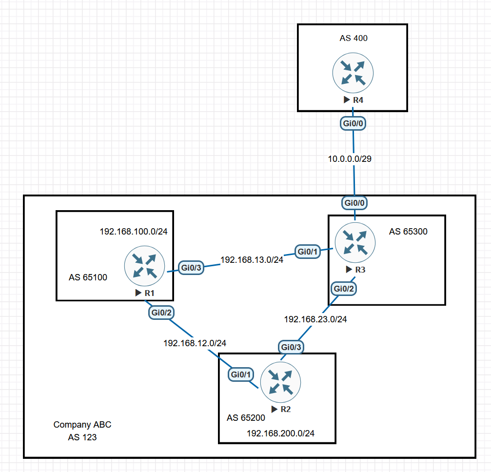

# BGP Suppress-Inactive and RIB Next-Hop Matching

This EVE-NG lab examines a Cisco BGP behaviour that is easy to miss: a route can be the best path in the BGP table even when a lower-Administrative-Distance route prevents it from entering the global Routing Information Base (RIB). Cisco IOS can still advertise that inactive BGP route to another neighbor by default.

The scenario is adapted from [CostiSer's Quiz #16](https://costiser.ro/2013/08/01/quiz-16/) and the published explanation, [BGP - Suppress-Inactive and Next-Hop Matches](https://costiser.ro/2013/10/19/bgp-suppress-inactive-and-next-hop-matches/). The topology and interface mapping below follow the EVE-NG lab shown in this document rather than copying the interfaces from the original article.

> [!NOTE]
> The core behaviour was reproduced on the EVE-NG lab: R3 initially advertised the inactive route, withdrew it when inactive-route suppression found different BGP and RIB next hops, and advertised it again when both next hops were made identical. The exact IOS image and supporting underlay captures were not retained, so version-sensitive statements are identified where relevant.

## Objectives

- Build a four-router BGP Confederation lab using the EVE-NG interface mapping shown below.
- Keep the R2-R3 physical link active while deliberately leaving BGP unconfigured on that link.
- Distinguish the BGP best path from the route installed in the global RIB.
- Reproduce a BGP RIB-failure caused by a lower-AD static route.
- Verify that Cisco IOS can advertise a BGP-best route even when that route is inactive in the RIB.
- Use `bgp suppress-inactive` without changing the existing `ALLOW-ALL` route map or applying another neighbor policy.
- Demonstrate why suppression also depends on whether the inactive BGP route and the active RIB route use the same next hop.

## Environment and Scope

- Platform: EVE-NG
- Nodes: four Cisco IOS routers
- External BGP AS: R4 in AS 400
- Confederation identifier: AS 123
- Confederation Member ASes:
  - R1: AS 65100
  - R2: AS 65200
  - R3: AS 65300
- Configured internal BGP sessions:
  - R1-R2 Confederation eBGP
  - R1-R3 Confederation eBGP
- Deliberately absent session:
  - R2-R3 has physical IP connectivity but no BGP neighbor relationship
- External session:
  - R3-R4 eBGP, with R4 treating Company ABC as AS 123

The loopback interfaces represent the two internal site prefixes. Platform-generated boilerplate and unused shutdown interfaces are omitted from the configuration excerpts.

## Control-Plane Model

The word *best* must be interpreted in the correct table:

```text
Received BGP paths
        |
        v
BGP best-path selection
        |
        |  One path receives the ">" marker
        v
Attempt to install the BGP-best path in the global RIB
        |
        +--> Installed successfully:  *>
        |
        +--> Rejected by the RIB:      r>
                 because another source has a lower AD
```

The default BGP advertisement decision is based on the BGP-selected path, not simply on whether that path won the global RIB installation decision.

| BGP status | Meaning | Normally eligible for advertisement |
| --- | --- | --- |
| `*` | Valid BGP path, but not selected as BGP best | No |
| `*>` | Valid BGP-best path and installed in the RIB | Yes |
| `r>` | BGP-best path rejected by the RIB | Yes on Cisco IOS by default |
| No `*` | Invalid path, commonly because its next hop is unreachable | No |

When `bgp suppress-inactive` is enabled, IOS adds another decision after the RIB rejects the BGP path:

```text
Is the path BGP best?
        |
        +-- No  --> Do not advertise it as the normal best path
        |
        +-- Yes --> Did it fail RIB installation?
                         |
                         +-- No  --> Advertise normally
                         |
                         +-- Yes --> Do the BGP and active-RIB next hops match?
                                          |
                                          +-- No  --> Suppress
                                          |
                                          +-- Yes --> Not suppressed by this command
```

This is why `r>` alone is not enough to predict the result after `bgp suppress-inactive` has been configured. The `r` and `>` flags do not change when only the active static next hop changes; the additional `RIB-NH Matches` result controls the suppression decision.

## Topology



### Addressing Plan

| Device | Interface | Address | Purpose |
| --- | --- | --- | --- |
| R1 | `Loopback0` | `192.168.100.1/24` | Site 1 prefix |
| R1 | `Gi0/2` | `192.168.12.1/24` | Link to R2 `Gi0/1` |
| R1 | `Gi0/3` | `192.168.13.1/24` | Link to R3 `Gi0/1` |
| R2 | `Loopback0` | `192.168.200.2/24` | Site 2 prefix |
| R2 | `Gi0/1` | `192.168.12.2/24` | Link to R1 `Gi0/2` |
| R2 | `Gi0/3` | `192.168.23.2/24` | New direct link to R3 `Gi0/2` |
| R3 | `Gi0/0` | `10.0.0.3/29` | External link to R4 `Gi0/0` |
| R3 | `Gi0/1` | `192.168.13.3/24` | Link to R1 `Gi0/3` |
| R3 | `Gi0/2` | `192.168.23.3/24` | New direct link to R2 `Gi0/3` |
| R4 | `Gi0/0` | `10.0.0.4/29` | External link to R3 `Gi0/0` |

R4 originates `10.0.0.0/8`, not the `10.0.0.0/29` transit subnet. Classic IOS may display this natural Class A prefix as `10.0.0.0` without an explicit `/8` suffix.

## Initial Configuration

The baseline deliberately creates the problem state. Do not configure the corrective command until the initial evidence has been collected.

### R1: Member AS 65100

```cisco
hostname R1
!
no ip domain lookup
ip cef
!
interface Loopback0
 description SITE-1-NETWORK
 ip address 192.168.100.1 255.255.255.0
!
interface GigabitEthernet0/2
 description TO-R2-Gi0/1
 ip address 192.168.12.1 255.255.255.0
 no shutdown
!
interface GigabitEthernet0/3
 description TO-R3-Gi0/1
 ip address 192.168.13.1 255.255.255.0
 no shutdown
!
router bgp 65100
 bgp router-id 1.1.1.1
 bgp log-neighbor-changes
 bgp confederation identifier 123
 bgp confederation peers 65200 65300
 neighbor 192.168.12.2 remote-as 65200
 neighbor 192.168.12.2 description R2-CONFED-EBGP
 neighbor 192.168.13.3 remote-as 65300
 neighbor 192.168.13.3 description R3-CONFED-EBGP
 network 192.168.100.0 mask 255.255.255.0
```

### R2: Member AS 65200

```cisco
hostname R2
!
no ip domain lookup
ip cef
!
interface Loopback0
 description SITE-2-NETWORK
 ip address 192.168.200.2 255.255.255.0
!
interface GigabitEthernet0/1
 description TO-R1-Gi0/2
 ip address 192.168.12.2 255.255.255.0
 no shutdown
!
interface GigabitEthernet0/3
 description TO-R3-Gi0/2-NO-BGP
 ip address 192.168.23.2 255.255.255.0
 no shutdown
!
router bgp 65200
 bgp router-id 2.2.2.2
 bgp log-neighbor-changes
 bgp confederation identifier 123
 bgp confederation peers 65100 65300
 neighbor 192.168.12.1 remote-as 65100
 neighbor 192.168.12.1 description R1-CONFED-EBGP
 network 192.168.200.0 mask 255.255.255.0
```

`65300` is declared as another Member AS, but there is deliberately no `neighbor 192.168.23.3 remote-as 65300` command. The `bgp confederation peers` statement identifies Member ASes; it does not create a BGP adjacency by itself.

### R3: Member AS 65300 and external edge

```cisco
hostname R3
!
no ip domain lookup
ip cef
!
interface GigabitEthernet0/0
 description TO-R4-Gi0/0
 ip address 10.0.0.3 255.255.255.248
 no shutdown
!
interface GigabitEthernet0/1
 description TO-R1-Gi0/3
 ip address 192.168.13.3 255.255.255.0
 no shutdown
!
interface GigabitEthernet0/2
 description TO-R2-Gi0/3-STATIC-ONLY
 ip address 192.168.23.3 255.255.255.0
 no shutdown
!
ip route 192.168.12.0 255.255.255.0 192.168.13.1
ip route 192.168.200.0 255.255.255.0 192.168.23.2
!
route-map ALLOW-ALL permit 10
!
router bgp 65300
 bgp router-id 3.3.3.3
 bgp log-neighbor-changes
 bgp confederation identifier 123
 bgp confederation peers 65100 65200
 neighbor 192.168.13.1 remote-as 65100
 neighbor 192.168.13.1 description R1-CONFED-EBGP
 neighbor 10.0.0.4 remote-as 400
 neighbor 10.0.0.4 description EXTERNAL-PARTNER-R4
 neighbor 10.0.0.4 route-map ALLOW-ALL out
```

The two static routes on R3 have different jobs:

- `192.168.12.0/24` via R1 makes the preserved BGP next hop `192.168.12.2` reachable.
- `192.168.200.0/24` via the new R2-R3 link makes the global RIB prefer the direct static path to Site 2.

The first route is necessary because Confederation eBGP preserves the next hop in this path. Without reachability to `192.168.12.2`, R3 may retain the prefix in its BGP table but will not select it as BGP best.

### R4: External AS 400

```cisco
hostname R4
!
no ip domain lookup
ip cef
!
interface GigabitEthernet0/0
 description TO-R3-Gi0/0
 ip address 10.0.0.4 255.255.255.248
 no shutdown
!
ip route 10.0.0.0 255.0.0.0 Null0
!
router bgp 400
 bgp router-id 4.4.4.4
 bgp log-neighbor-changes
 neighbor 10.0.0.3 remote-as 123
 neighbor 10.0.0.3 description COMPANY-ABC-AS123
 network 10.0.0.0 mask 255.0.0.0
```

The Null0 route provides the exact `/8` RIB entry required by the BGP `network` statement. The connected `/29` remains the longest match for traffic on the R3-R4 link.

## Stage 1: Reproduce the Inactive-Route Advertisement

### Confirm the BGP best path and RIB failure on R3

The following output was captured before `bgp suppress-inactive` was configured:

```text
R3# show ip bgp
BGP table version is 8, local router ID is 3.3.3.3
Status codes: s suppressed, d damped, h history, * valid, > best, i - internal,
              r RIB-failure, S Stale, m multipath, b backup-path, f RT-Filter,
              x best-external, a additional-path, c RIB-compressed,
              t secondary path,
Origin codes: i - IGP, e - EGP, ? - incomplete
RPKI validation codes: V valid, I invalid, N Not found

     Network          Next Hop            Metric LocPrf Weight Path
 *>   10.0.0.0         10.0.0.4                 0             0 400 i
 *>   192.168.100.0    192.168.13.1             0    100      0 (65100) i
 r>   192.168.200.0    192.168.12.2             0    100      0 (65100 65200) i

R4# show ip bgp
BGP table version is 8, local router ID is 4.4.4.4
Status codes: s suppressed, d damped, h history, * valid, > best, i - internal,
              r RIB-failure, S Stale, m multipath, b backup-path, f RT-Filter,
              x best-external, a additional-path, c RIB-compressed,
              t secondary path,
Origin codes: i - IGP, e - EGP, ? - incomplete
RPKI validation codes: V valid, I invalid, N Not found

     Network          Next Hop            Metric LocPrf Weight Path
 *>   10.0.0.0         0.0.0.0                  0         32768 i
 *>   192.168.100.0    10.0.0.3                               0 123 i
 *>   192.168.200.0    10.0.0.3                               0 123 i
```

```text
R3# show ip bgp rib-failure
  Network            Next Hop                      RIB-failure   RIB-NH Matches
192.168.200.0      192.168.12.2        Higher admin distance              n/a

R3# show ip bgp neighbor 10.0.0.4 advertised-routes
BGP table version is 8, local router ID is 3.3.3.3
Status codes: s suppressed, d damped, h history, * valid, > best, i - internal,
              r RIB-failure, S Stale, m multipath, b backup-path, f RT-Filter,
              x best-external, a additional-path, c RIB-compressed,
              t secondary path,
Origin codes: i - IGP, e - EGP, ? - incomplete
RPKI validation codes: V valid, I invalid, N Not found

     Network          Next Hop            Metric LocPrf Weight Path
 *>   192.168.100.0    192.168.13.1             0    100      0 (65100) i
 r>   192.168.200.0    192.168.12.2             0    100      0 (65100 65200) i

Total number of prefixes 2
```

Spacing and prefix-length display vary by image. The important evidence for `192.168.200.0/24` is:

- `>`: it is the BGP best path.
- `r`: it lost RIB installation to the static route.
- BGP next hop: `192.168.12.2`.
- Installed static next hop: `192.168.23.2`.
- Confederation path: `(65100 65200)`.

The captures confirm the default behaviour:

- R3 advertises both `192.168.100.0/24` and `192.168.200.0/24` to R4.
- R4 sees Company ABC as AS 123; the internal Member AS sequence is removed when the route leaves the Confederation.
- R4 selects `192.168.200.0/24` through `10.0.0.3` even though R3 forwards that prefix through its static route to `192.168.23.2`.

## Root Cause

R3 has two independent decisions for the same prefix:

| Decision | Winning route | Reason |
| --- | --- | --- |
| BGP best-path selection | BGP path through R1, next hop `192.168.12.2` | It is the selected path within the BGP table. |
| Global RIB installation | Static route through R2, next hop `192.168.23.2` | Static AD 1 is lower than the BGP route's AD. |

The BGP route remains marked `r>`: inactive in the global RIB, but still the selected BGP path. Cisco IOS advertises such a path by default. This explains why a route that R3 does not use for forwarding can still be visible on R4.

The existing `ALLOW-ALL` route map does exactly what its name implies. Editing it or attaching a second outbound neighbor policy would hide the symptom, but the quiz explicitly excludes those approaches.

## Stage 2: Suppress the Inactive Advertisement

`bgp suppress-inactive` changes the default treatment of selected BGP routes that failed RIB installation. The next-hop comparison introduced later in this lab is an additional condition and must not be overlooked.

Apply the correction only on R3:

```cisco
R3# configure terminal
R3(config)# router bgp 65300
R3(config-router)# bgp suppress-inactive
R3(config-router)# end
```

Some IOS XE address-family configurations place the command under `address-family ipv4 unicast`. Use contextual help on the selected image if the router rejects the classic IOS placement.

### Verify the suppression decision

```text
R3# show ip bgp rib-failure
  Network            Next Hop                      RIB-failure   RIB-NH Matches
192.168.200.0      192.168.12.2        Higher admin distance               No


R3# show ip bgp
BGP table version is 9, local router ID is 3.3.3.3
Status codes: s suppressed, d damped, h history, * valid, > best, i - internal,
              r RIB-failure, S Stale, m multipath, b backup-path, f RT-Filter,
              x best-external, a additional-path, c RIB-compressed,
              t secondary path,
Origin codes: i - IGP, e - EGP, ? - incomplete
RPKI validation codes: V valid, I invalid, N Not found

     Network          Next Hop            Metric LocPrf Weight Path
 *>   10.0.0.0         10.0.0.4                 0             0 400 i
 *>   192.168.100.0    192.168.13.1             0    100      0 (65100) i
 r>   192.168.200.0    192.168.12.2             0    100      0 (65100 65200) i


R3# show ip bgp neighbor 10.0.0.4 advertised-routes
BGP table version is 9, local router ID is 3.3.3.3
Status codes: s suppressed, d damped, h history, * valid, > best, i - internal,
              r RIB-failure, S Stale, m multipath, b backup-path, f RT-Filter,
              x best-external, a additional-path, c RIB-compressed,
              t secondary path,
Origin codes: i - IGP, e - EGP, ? - incomplete
RPKI validation codes: V valid, I invalid, N Not found

     Network          Next Hop            Metric LocPrf Weight Path
 *>   192.168.100.0    192.168.13.1             0    100      0 (65100) i

Total number of prefixes 1


R4# show ip bgp
BGP table version is 9, local router ID is 4.4.4.4
Status codes: s suppressed, d damped, h history, * valid, > best, i - internal,
              r RIB-failure, S Stale, m multipath, b backup-path, f RT-Filter,
              x best-external, a additional-path, c RIB-compressed,
              t secondary path,
Origin codes: i - IGP, e - EGP, ? - incomplete
RPKI validation codes: V valid, I invalid, N Not found

     Network          Next Hop            Metric LocPrf Weight Path
 *>   10.0.0.0         0.0.0.0                  0         32768 i
 *>   192.168.100.0    10.0.0.3                               0 123 i
```

The BGP entry on R3 remains `r>` because neither of the two decisions represented by those flags changed:

- `>` remains because the path through R1 is still R3's BGP best path.
- `r` remains because the lower-AD static route through `192.168.23.2` is still installed in the global RIB.

What changed is the export decision. With `bgp suppress-inactive` active, IOS compares the selected BGP next hop (`192.168.12.2`) with the installed static next hop (`192.168.23.2`). `RIB-NH Matches: No` makes the inactive path ineligible for advertisement, so R3 withdraws `192.168.200.0/24` from R4 while continuing to advertise `192.168.100.0/24`.

## Stage 3: Test the RIB Next-Hop Match Condition

This experiment demonstrates that inactive-route suppression is conditional. Save the Stage 2 evidence before changing the static route.

Replace the direct-link static route with one whose next hop matches the BGP next hop:

```cisco
R3# configure terminal
R3(config)# no ip route 192.168.200.0 255.255.255.0 192.168.23.2
R3(config)# ip route 192.168.200.0 255.255.255.0 192.168.12.2
R3(config)# end
```

Then verify:

```text
R3# show ip bgp rib-failure
  Network            Next Hop                      RIB-failure   RIB-NH Matches
192.168.200.0      192.168.12.2        Higher admin distance              Yes

R3# show ip bgp neighbors 10.0.0.4 advertised-routes
BGP table version is 11, local router ID is 3.3.3.3
Status codes: s suppressed, d damped, h history, * valid, > best, i - internal,
              r RIB-failure, S Stale, m multipath, b backup-path, f RT-Filter,
              x best-external, a additional-path, c RIB-compressed,
              t secondary path,
Origin codes: i - IGP, e - EGP, ? - incomplete
RPKI validation codes: V valid, I invalid, N Not found

     Network          Next Hop            Metric LocPrf Weight Path
 *>   192.168.100.0    192.168.13.1             0    100      0 (65100) i
 r>   192.168.200.0    192.168.12.2             0    100      0 (65100 65200) i

Total number of prefixes 2

R4# show ip bgp 192.168.200.0
BGP routing table entry for 192.168.200.0/24, version 10
Paths: (1 available, best #1, table default)
  Not advertised to any peer
  Refresh Epoch 1
  123
    10.0.0.3 from 10.0.0.3 (3.3.3.3)
      Origin IGP, localpref 100, valid, external, best
      rx pathid: 0, tx pathid: 0x0
```

### Why R3 advertises the route again while it is still `r>`

Changing the static route does not change the reason for the RIB failure:

```text
Static route AD:                         1
BGP route AD:                           higher
Result:                    static route stays in the RIB
BGP-table status:                         r>
```

The route therefore remains:

- `>` because it is still the selected path inside the BGP table;
- `r` because the static route still prevents that BGP path from entering the global RIB.

However, `bgp suppress-inactive` is not implemented as a blanket rule that says “suppress every route marked `r`.” Cisco's TAC-authored explanation states that only RIB-failure routes whose BGP next hop differs from the next hop in the routing table are suppressed. The same document demonstrates one route with `RIB-NH Matches: No` being withdrawn while another route with `RIB-NH Matches: Yes` remains advertised. See [Cisco: Understand BGP RIB-Failure and the BGP Suppress-Inactive Command](https://www.cisco.com/c/en/us/support/docs/ip/border-gateway-protocol-bgp/213286-understand-bgp-rib-failure-and-the-bgp-s.html).

| State | BGP next hop | Active RIB next hop | `RIB-NH Matches` | Effect of `bgp suppress-inactive` |
| --- | --- | --- | --- | --- |
| Original static route | `192.168.12.2` | `192.168.23.2` | `No` | Suppressed |
| Modified static route | `192.168.12.2` | `192.168.12.2` | `Yes` | Not suppressed; advertised in this lab |

After the static next hop is changed to `192.168.12.2`, R3 would forward traffic for `192.168.200.0/24` to the same next hop identified by its BGP best path. The static route still wins because of AD, so the BGP route remains inactive, but there is no longer a forwarding next-hop disagreement. IOS therefore exempts this inactive route from suppression and installs it in the Adj-RIB-Out for R4 again.

The sequence can be read directly from the captured evidence:

```text
R3 BGP table:                    r>  (unchanged)
R3 RIB-NH Matches:              Yes
R3 advertised-routes:           192.168.200.0/24 is present again
R4 BGP table:                    192.168.200.0/24 received from 10.0.0.3
```

On R4, `Not advertised to any peer` means that R4 is not advertising this learned route onward to another BGP neighbor. It does **not** mean that R4 failed to receive the route from R3. The following lines prove reception and selection on R4:

```text
Paths: (1 available, best #1, table default)
10.0.0.3 from 10.0.0.3
Origin IGP, localpref 100, valid, external, best
```

The important distinction is therefore:

```text
r>                         = BGP best, but rejected by the global RIB
RIB-NH Matches: No         = suppress this inactive route
RIB-NH Matches: Yes        = not suppressed by this command
```

Restore the topology's intended direct R2-R3 forwarding path immediately after the experiment:

```cisco
R3# configure terminal
R3(config)# no ip route 192.168.200.0 255.255.255.0 192.168.12.2
R3(config)# ip route 192.168.200.0 255.255.255.0 192.168.23.2
R3(config)# end
```

## Common Reconstruction Errors

### Advertising the transit `/29` from R4

If R4 originates `10.0.0.0/29`, R3 already owns the identical prefix as a connected route and the learned BGP path appears as `r>`:

```text
r> 10.0.0.0/29    10.0.0.4    0    0 400 i
```

The source scenario instead uses `10.0.0.0/8`. The connected `/29` and learned `/8` can coexist because they are different prefixes.

### Omitting reachability to `192.168.12.2`

If R3 cannot resolve the preserved BGP next hop, `192.168.200.0/24` may appear in the BGP table without `>` and will not be advertised. Verify:

```cisco
R3# show ip route 192.168.12.2
R3# show ip bgp 192.168.200.0
```

The baseline route through R1 is:

```cisco
ip route 192.168.12.0 255.255.255.0 192.168.13.1
```

### Establishing R2-R3 BGP too early

Do not add these commands during the baseline:

```cisco
R2(config-router)# neighbor 192.168.23.3 remote-as 65300
R3(config-router)# neighbor 192.168.23.2 remote-as 65200
```

A direct session changes R3's learned path and next hop. The expected indirect path `(65100 65200)` through R1 would no longer represent the source scenario.

### Confusing a Confederation declaration with a neighbor

This command records Confederation Member ASes:

```cisco
bgp confederation peers 65100 65200
```

It does not create a TCP session or BGP adjacency. An actual adjacency requires a corresponding `neighbor ... remote-as ...` command.

## Verification Coverage

The retained CLI evidence demonstrates:

1. R3 selected `192.168.200.0/24` as BGP best while reporting a RIB failure.
2. Before suppression, R3 advertised both internal prefixes and R4 installed both through AS 123.
3. After `bgp suppress-inactive`, R3 reported `RIB-NH Matches: No` and stopped advertising `192.168.200.0/24`.
4. R4 removed `192.168.200.0/24` while retaining `192.168.100.0/24`.
5. After the static next hop was changed to match the BGP next hop, R3 still displayed `r>` but reported `RIB-NH Matches: Yes`.
6. In the same-next-hop state, R3 advertised `192.168.200.0/24` again and R4 selected the received route as its best path.

The following supporting artifacts were not retained and remain useful repeat-run improvements:

- `show version` or the exact IOS image and release.
- `show ip bgp summary` from all four routers.
- `show ip route 192.168.12.2` proving recursive reachability to the preserved BGP next hop.
- `show ip route 192.168.200.0` before and after the static next-hop experiment.

## Rollback

Remove inactive-route suppression and restore the original quiz state:

```cisco
R3# configure terminal
R3(config)# router bgp 65300
R3(config-router)# no bgp suppress-inactive
R3(config-router)# end
```

Confirm that the topology's intended static next hop is restored:

```cisco
R3# show running-config | include ^ip route 192.168.200.0
```

Expected configuration:

```cisco
ip route 192.168.200.0 255.255.255.0 192.168.23.2
```

## Operational Considerations

- `bgp suppress-inactive` is a BGP process or address-family behaviour, not a per-neighbor filter. Review every inactive prefix before enabling it on a production edge.
- A RIB-failure does not mean that BGP failed to choose a path. The `>` marker and `show ip bgp rib-failure` must be read together.
- The suppression decision can depend on whether the selected BGP next hop matches the active RIB next hop.
- The command does not replace normal export policy. Production eBGP sessions should still use explicit prefix controls appropriate to the routing policy.
- Confederation eBGP preserves attributes differently from ordinary external eBGP. Ensure that preserved next hops are reachable through the internal underlay.
- The `/8` originated by R4 exists to reproduce the source output and is not a recommendation to advertise broad private-address aggregates in production.
- Command placement and displayed fields can differ between classic IOS, IOS XE, and IOS XR. Record the exact image before comparing output literally.

## Key Lessons

- BGP best-path selection and global RIB route selection are separate decisions.
- A route marked `r>` is still the BGP best path even though another routing source owns the forwarding entry.
- Cisco IOS advertises selected inactive BGP routes by default.
- A route marked only `*`, without `>`, is not the selected BGP path and is not normally advertised.
- `bgp suppress-inactive` suppresses eligible inactive advertisements without requiring a neighbor route map.
- `bgp suppress-inactive` does not suppress every `r>` route; a matching BGP and RIB next hop remains eligible for advertisement on the tested IOS behaviour.
- Changing the static next hop can change the export decision without changing the route's `r>` status.
- An indirect Confederation path requires reachability to the preserved next hop.
- `bgp confederation peers` identifies Member ASes; it does not establish a neighbor session.
- Exact prefix length matters: `10.0.0.0/8` and `10.0.0.0/29` are different routes and produce different RIB-failure behaviour.
- `Not advertised to any peer` in R4's prefix detail describes R4's outbound advertisement state, not whether R4 received the route from R3.

## References

- [CostiSer: Quiz #16 - BGP Filtering Updates](https://costiser.ro/2013/08/01/quiz-16/)
- [CostiSer: BGP - Suppress-Inactive and Next-Hop Matches](https://costiser.ro/2013/10/19/bgp-suppress-inactive-and-next-hop-matches/)
- [Cisco: Understand BGP RIB-Failure and the BGP Suppress-Inactive Command](https://www.cisco.com/c/en/us/support/docs/ip/border-gateway-protocol-bgp/213286-understand-bgp-rib-failure-and-the-bgp-s.html)
- [Cisco IOS XE BGP Configuration Guide: Suppressing Inactive Route Advertisement](https://www.cisco.com/c/en/us/td/docs/ios-xml/ios/iproute_bgp/configuration/xe-16-12/irg-xe-16-12-book/configuring-a-basic-bgp-network.html)
- [Cisco: Troubleshoot Border Gateway Protocol Basic Issues](https://www.cisco.com/c/en/us/support/docs/ip/border-gateway-protocol-bgp/218027-troubleshoot-border-gateway-protocol-bas.html)
- [RFC 5065: Autonomous System Confederations for BGP](https://datatracker.ietf.org/doc/rfc5065/)
