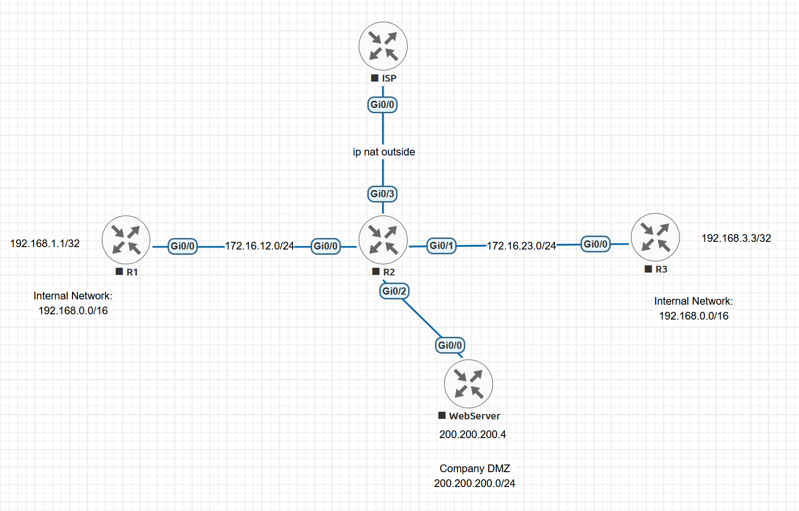

# Static NAT Between Two Partners Using DMZ Addresses

This EVE-NG lab connects two partner networks that both use `192.168.0.0/16` through a border router that cannot enable NAT on its DMZ interface. Each partner is presented to the other by an unused address from the company's public DMZ range, `200.200.200.0/24`. That range is directly connected to the DMZ, so whether a translated packet reaches the other partner or is sent into the DMZ depends on the order of NAT and routing in legacy Cisco IOS.

The scenario was adapted from [CostiSer's Quiz #20](https://costiser.ro/2013/10/26/quiz-20/). The quiz has no separate published solution article. In the comments on the quiz page, the author identified the intended answer as configuring **both** partner-facing interfaces as `ip nat outside` with four static mappings. He also accepted an `ip nat inside` / `ip nat outside` design that adds a host route through `add-route`. This lab reproduces and compares both designs, then checks every conclusion against Cisco documentation.

> [!NOTE]
> The lab has been reproduced in EVE-NG. The retained CLI evidence covers:
>
> - the baseline DMZ sessions;
> - the NAT aliases and their RIB and CEF state;
> - the failed and corrected Solution A tests;
> - the `add-route` variant;
> - the Solution B configuration and sessions;
> - the DMZ side-effect tests for both solutions.
>
> Some evidence was not retained; see [Evidence Not Retained](#evidence-not-retained).

## Objectives

- Explain, from Cisco's documented NAT order of operations, why an inside-to-outside translation fails when the outside-local address belongs to a connected subnet.
- Implement Solution A: `ip nat inside` toward Partner-DB, `ip nat outside` toward Partner-APP, and a `/32` route for the outside-local address.
- Show how the NAT alias for that address suppresses a manual `/32` route, and how `no-alias` corrects it.
- Implement Solution B: `ip nat outside` on both partner-facing interfaces, with inside and outside static mappings for both partners.
- Verify that existing traffic between the partners and the DMZ is not translated by either solution.
- Separate the behaviour that Cisco documents from the behaviour observed only on the tested image.

## Environment and Scope

- Platform: EVE-NG
- Nodes: five Cisco IOS routers
- R1: Partner-DB border router; `Loopback0` represents the database server
- R2: company border router and NAT device
- R3: Partner-APP border router; `Loopback0` represents the application server
- WebServer: company DMZ web server, implemented as a router
- ISP: simulated Internet router
- NAT model: legacy `ip nat inside` and `ip nat outside`, not NAT Virtual Interface (NVI)
- Routing: static routes only

The quiz's internal LAN and its inside-source PAT are not part of this topology. The ISP link keeps `ip nat outside` so that R2's NAT configuration matches the original scenario.

Platform-generated boilerplate and unused shutdown interfaces are omitted from the configuration excerpts.

## Topology



| Device | Interface | Address | Role |
| --- | --- | --- | --- |
| R1 | `Gi0/0` | `172.16.12.1/24` | Link to R2 |
| R1 | `Loopback0` | `192.168.1.1/32` | Partner-DB server |
| R2 | `Gi0/0` | `172.16.12.2/24` | Partner-DB link; no NAT in the baseline |
| R2 | `Gi0/1` | `172.16.23.2/24` | Partner-APP link; no NAT in the baseline |
| R2 | `Gi0/2` | `200.200.200.254/24` | Company DMZ; NAT must never be enabled |
| R2 | `Gi0/3` | `25.25.25.6/30` | ISP link; `ip nat outside` |
| R3 | `Gi0/0` | `172.16.23.3/24` | Link to R2 |
| R3 | `Loopback0` | `192.168.3.3/32` | Partner-APP server |
| WebServer | `Gi0/0` | `200.200.200.4/24` | DMZ web server |
| ISP | `Gi0/0` | `25.25.25.5/30` | Simulated Internet link |

R2 uses `200.200.200.254` on the DMZ so that `.1` and `.3` remain unused, as the quiz requires. Both partners use addresses from `192.168.0.0/16`, and neither partner router can perform NAT.

## Translation Requirement

Each partner must see the other through a DMZ address, and only for partner-to-partner traffic:

| Real address | Address seen by the other partner |
| --- | --- |
| `192.168.1.1` (Partner-DB) | `200.200.200.1` |
| `192.168.3.3` (Partner-APP) | `200.200.200.3` |

The constraints are:

- NAT cannot be enabled on R2 `Gi0/2`, because that would affect production DMZ services.
- R1 and R3 already route `200.200.200.0/24` to R2 and cannot perform NAT.
- WebServer `200.200.200.4` must keep reaching both partners without translation.

## Documented Cisco Behaviour

The analysis in this lab relies on the following documented behaviour. Each conclusion later in the document cites the item it depends on, using the labels **D1** to **D7**. Conclusions that go beyond these sources are marked as observed or inferred.

| Ref | Documented behaviour | Source |
| --- | --- | --- |
| D1 | Inside-to-outside translation occurs after routing. Outside-to-inside translation occurs before routing. | [NAT Order of Operation](https://www.cisco.com/c/en/us/support/docs/ip/network-address-translation-nat/6209-5.html); [NAT FAQ](https://www.cisco.com/c/en/us/support/docs/ip/network-address-translation-nat/26704-nat-faq-00.html) |
| D2 | For inside-to-outside traffic, the router must find a route to the destination before translating, and that route must use an interface configured as NAT outside. | [NAT Order of Operation](https://www.cisco.com/c/en/us/support/docs/ip/network-address-translation-nat/6209-5.html) |
| D3 | "Only packets moving between inside and outside interfaces can be translated." The NAT FAQ also states that NAT requires both an inside and an outside interface. | [`ip nat` command reference](https://www.cisco.com/c/en/us/td/docs/ios-xml/ios/ipaddr/command/ipaddr-cr-book/ipaddr-i3.html); [NAT FAQ](https://www.cisco.com/c/en/us/support/docs/ip/network-address-translation-nat/26704-nat-faq-00.html) |
| D4 | When an inside-global address matches a local interface, NAT installs an IP alias and an ARP entry, and the router can answer ARP for that address. `no-alias` prevents the alias. On `ip nat inside source static`, it applies to the global address. On `ip nat outside source static`, it applies to the local address. | [NAT FAQ](https://www.cisco.com/c/en/us/support/docs/ip/network-address-translation-nat/26704-nat-faq-00.html); [`ip nat inside source` / `ip nat outside source` command reference](https://www.cisco.com/c/en/us/td/docs/ios-xml/ios/ipaddr/command/ipaddr-cr-book/ipaddr-i3.html) |
| D5 | `add-route` on `ip nat outside source` adds a static route for the outside-local address. The command reference describes `extendable` only as an option that extends the translation. | [`ip nat outside source` command reference](https://www.cisco.com/c/en/us/td/docs/ios-xml/ios/ipaddr/command/ipaddr-cr-book/ipaddr-i3.html) |
| D6 | The default administrative distance is 0 for a connected route and 1 for a static route. The route with the lower administrative distance is installed. | [What Is Administrative Distance?](https://www.cisco.com/c/en/us/support/docs/ip/border-gateway-protocol-bgp/15986-admin-distance.html) |
| D7 | Proxy ARP is enabled by default on Cisco IOS. A router answers a Proxy ARP request when Proxy ARP is enabled on the receiving interface and the router has a route to the target through a different interface. | [Understand Proxy ARP](https://www.cisco.com/c/en/us/support/docs/ip/dynamic-address-allocation-resolution/13718-5.html) |

The borrowed addresses `200.200.200.1` and `200.200.200.3` are inside the connected DMZ subnet. By D1 and D2, any design that routes one of these addresses before translating it must have a more-specific route toward an outside interface. Without that route, the lookup matches the DMZ.

## Baseline Configuration

### R1: Partner-DB

```cisco
hostname R1
!
no ip domain lookup
ip cef
!
interface Loopback0
 description PARTNER-DB-SERVER
 ip address 192.168.1.1 255.255.255.255
!
interface GigabitEthernet0/0
 description TO-R2-Gi0/0
 ip address 172.16.12.1 255.255.255.0
 no shutdown
!
ip route 200.200.200.0 255.255.255.0 172.16.12.2
!
line vty 0 4
 no login
 transport input telnet
```

### R2: company border router

```cisco
hostname R2
!
no ip domain lookup
ip cef
!
interface GigabitEthernet0/0
 description TO-R1-PARTNER-DB
 ip address 172.16.12.2 255.255.255.0
 no shutdown
!
interface GigabitEthernet0/1
 description TO-R3-PARTNER-APP
 ip address 172.16.23.2 255.255.255.0
 no shutdown
!
interface GigabitEthernet0/2
 description COMPANY-DMZ
 ip address 200.200.200.254 255.255.255.0
 no shutdown
!
interface GigabitEthernet0/3
 description TO-ISP
 ip address 25.25.25.6 255.255.255.252
 ip nat outside
 no shutdown
!
ip route 192.168.1.1 255.255.255.255 172.16.12.1
ip route 192.168.3.3 255.255.255.255 172.16.23.3
ip route 0.0.0.0 0.0.0.0 25.25.25.5
```

### R3: Partner-APP

```cisco
hostname R3
!
no ip domain lookup
ip cef
!
interface Loopback0
 description PARTNER-APP-SERVER
 ip address 192.168.3.3 255.255.255.255
!
interface GigabitEthernet0/0
 description TO-R2-Gi0/1
 ip address 172.16.23.3 255.255.255.0
 no shutdown
!
ip route 200.200.200.0 255.255.255.0 172.16.23.2
!
line vty 0 4
 no login
 transport input telnet
```

### WebServer

```cisco
hostname WebServer
!
no ip domain lookup
ip cef
!
interface GigabitEthernet0/0
 description COMPANY-DMZ
 ip address 200.200.200.4 255.255.255.0
 no shutdown
!
ip route 0.0.0.0 0.0.0.0 200.200.200.254
!
line vty 0 4
 no login
 transport input telnet
```

### ISP

```cisco
hostname ISP
!
no ip domain lookup
ip cef
!
interface GigabitEthernet0/0
 description TO-R2-Gi0/3
 ip address 25.25.25.5 255.255.255.252
 no shutdown
```

> [!WARNING]
> `no login` on the VTY lines is used only so that Telnet can prove which device terminates a session. Do not use it outside an isolated lab.

## Test Method

Ping alone is not sufficient evidence in this lab. When NAT creates an alias for a borrowed DMZ address (D4), R2 owns that address, so a ping reply can come from R2 instead of the intended partner. Each connectivity test therefore uses Telnet from a loopback and runs `show tcp brief` inside the remote session. The output identifies the device that accepted the connection and the source address it observed.

The partner-to-partner test is:

```cisco
R3#telnet 200.200.200.1 /source-interface Loopback0
R1>show tcp brief
R1>exit

R1#telnet 200.200.200.3 /source-interface Loopback0
R3>show tcp brief
R3>exit
```

A correct result is R1 seeing foreign address `200.200.200.3`, and R3 seeing foreign address `200.200.200.1`.

The partner-to-DMZ test uses the same method against WebServer:

```cisco
R1#telnet 200.200.200.4 /source-interface Loopback0
WebServer>show tcp brief
WebServer>exit

R3#telnet 200.200.200.4 /source-interface Loopback0
WebServer>show tcp brief
WebServer>exit
```

A correct result is WebServer seeing the untranslated foreign addresses `192.168.1.1` and `192.168.3.3`.

Clear old dynamic translations on R2 before each controlled test:

```cisco
R2#clear ip nat translation *
```

## Stage 1: Verify the Baseline

```text
WebServer#ping 192.168.1.1
Type escape sequence to abort.
Sending 5, 100-byte ICMP Echos to 192.168.1.1, timeout is 2 seconds:
!!!!!
Success rate is 100 percent (5/5), round-trip min/avg/max = 1/1/2 ms
WebServer#ping 192.168.3.3
Type escape sequence to abort.
Sending 5, 100-byte ICMP Echos to 192.168.3.3, timeout is 2 seconds:
!!!!!
Success rate is 100 percent (5/5), round-trip min/avg/max = 2/2/3 ms

R1#telnet 200.200.200.4 /source-interface Loopback0
Trying 200.200.200.4 ... Open
WebServer>show tcp brief
TCB       Local Address               Foreign Address             (state)
1081C790  200.200.200.4.23           192.168.1.1.43359           ESTAB

R3#telnet 200.200.200.4 /source-interface Loopback0
Trying 200.200.200.4 ... Open
WebServer>show tcp brief
TCB       Local Address               Foreign Address             (state)
1081C790  200.200.200.4.23           192.168.1.1.43359           TIMEWAIT
1153CD60  200.200.200.4.23           192.168.3.3.23665           ESTAB
```

**Observed:** both partners reach WebServer, and WebServer sees the untranslated addresses `192.168.1.1` and `192.168.3.3`. This is the production behaviour that must survive both solutions.

## Stage 2: Solution A, Inside and Outside with a Host Route

### NAT address identities

| NAT field | Address | Meaning |
| --- | --- | --- |
| Inside local | `192.168.1.1` | Real Partner-DB address |
| Inside global | `200.200.200.1` | Partner-DB as seen by Partner-APP |
| Outside global | `192.168.3.3` | Real Partner-APP address |
| Outside local | `200.200.200.3` | Partner-APP as seen by Partner-DB |

### 2.1 Configure the static mappings without a host route

```cisco
R2(config)#interface GigabitEthernet0/0
R2(config-if)# ip nat inside
R2(config-if)#interface GigabitEthernet0/1
R2(config-if)# ip nat outside
R2(config-if)#exit
R2(config)#ip nat inside source static 192.168.1.1 200.200.200.1
R2(config)#ip nat outside source static 192.168.3.3 200.200.200.3
```

Inspect the alias, RIB, and CEF state for both borrowed addresses:

```text
R2#show ip aliases
Address Type             IP Address      Port
Interface                25.25.25.6 
Interface                172.16.12.2 
Interface                172.16.23.2 
Dynamic                  200.200.200.1 
Dynamic                  200.200.200.3 
Interface                200.200.200.254 
R2#show ip route 200.200.200.1
Routing entry for 200.200.200.1/32
  Known via "connected", distance 0, metric 0 (connected)
  Routing Descriptor Blocks:
  * directly connected, via GigabitEthernet0/2
      Route metric is 0, traffic share count is 1
      
R2#show ip route 200.200.200.3
Routing entry for 200.200.200.3/32
  Known via "connected", distance 0, metric 0 (connected)
  Routing Descriptor Blocks:
  * directly connected, via GigabitEthernet0/2
      Route metric is 0, traffic share count is 1
      
R2#show ip cef 200.200.200.3 detail
200.200.200.3/32, epoch 0, flags [receive, source eligible]
  receive
```

**Observed:** both borrowed addresses are `Dynamic` aliases. Each is installed as a connected `/32` on `Gi0/2`, and CEF classifies `200.200.200.3` as a `receive` entry.

**Documented basis:** D4 states that NAT installs an alias for an inside-global address that matches a local interface. The command reference also describes `no-alias` for the outside-local address of an outside-source mapping, which implies that an alias is created for that address by default. Cisco's documentation does not describe the connected `/32` RIB entry or the CEF `receive` flag. These are how the tested image represents the aliases, and the [overlapping-networks NAT lab](./NAT%20Between%20Overlapping%20Networks.md) recorded the same representation.

Run the partner-to-partner tests:

```text
R3#telnet 200.200.200.1 /source-interface Loopback0
Trying 200.200.200.1 ... 
% Connection timed out; remote host not responding

R1#telnet 200.200.200.3 /source-interface Loopback0
Trying 200.200.200.3 ... 
% Connection refused by remote host
```

**Observed:** both directions fail, with different symptoms.

**Analysis:**

- **R3 to R1 times out.**
  - The SYN enters outside interface `Gi0/1` and is translated before routing (D1). Source `192.168.3.3` becomes `200.200.200.3`, and destination `200.200.200.1` becomes `192.168.1.1`.
  - R1's reply to `200.200.200.3` enters inside interface `Gi0/0`, where R2 routes before translating (D1).
  - D2 requires a route through an outside interface. The only matching route is the connected `/32` on the DMZ interface `Gi0/2`, which is not an outside interface, so the reply is not translated toward R3.
  - The `receive` entry indicates that R2 treats the address as its own. **Inference:** the reply is therefore handled by R2 locally.
- **R1 to R3 is refused.**
  - The SYN to `200.200.200.3` enters inside interface `Gi0/0` and meets the same routing lookup.
  - R3 accepts Telnet (`no login`), so the TCP refusal did not come from R3. **Inference:** it came from R2, which owns the alias address. This is the false-endpoint case that the Telnet test method is designed to expose.

### 2.2 Add the `/32` route for the outside-local address

The route below is the correction that the quiz author accepted, expressed as a manual route:

```cisco
R2(config)#ip route 200.200.200.3 255.255.255.255 172.16.23.3
```

```text
R2#show ip route 200.200.200.3
Routing entry for 200.200.200.3/32
  Known via "connected", distance 0, metric 0 (connected)
  Routing Descriptor Blocks:
  * directly connected, via GigabitEthernet0/2
      Route metric is 0, traffic share count is 1
R2#show ip cef 200.200.200.3 detail
200.200.200.3/32, epoch 0, flags [receive, source eligible]
  receive
```

**Observed:** the static route is configured but not installed. The RIB and CEF are unchanged.

**Documented basis:** the connected `/32` and the static `/32` have the same prefix length, so administrative distance decides. Connected (0) wins over static (1), as D6 states. The manual route cannot take effect while the alias exists.

### 2.3 Remove the outside-local alias with `no-alias`

Replace the outside-source mapping with a version that does not create an alias (D4). The translation itself is unchanged:

```cisco
R2(config)#no ip nat outside source static 192.168.3.3 200.200.200.3
R2(config)#ip nat outside source static 192.168.3.3 200.200.200.3 no-alias
```

The inside-source alias for `200.200.200.1` is left in place. Partner traffic to that address enters an outside interface and is translated before routing (D1), so the alias does not affect it.

### 2.4 Verify partner-to-partner connectivity

```text
R2#show ip route 200.200.200.3
Routing entry for 200.200.200.3/32
  Known via "static", distance 1, metric 0
  Routing Descriptor Blocks:
  * 172.16.23.3
      Route metric is 0, traffic share count is 1
R2#show ip cef 200.200.200.3 detail
200.200.200.3/32, epoch 0
  recursive via 172.16.23.3
    attached to GigabitEthernet0/1

R3#telnet 200.200.200.1 /source-interface Loopback0
Trying 200.200.200.1 ... Open
R1>show tcp brief
TCB       Local Address               Foreign Address             (state)
10CC6EC8  192.168.1.1.23             200.200.200.3.63018         ESTAB

R1#telnet 200.200.200.3 /source-interface Loopback0
Trying 200.200.200.3 ... Open
R3>show tcp brief
TCB       Local Address               Foreign Address             (state)
1153B928  192.168.3.3.23             200.200.200.1.64075         ESTAB
```

```text
R2#show ip nat translations
Pro Inside global      Inside local       Outside local      Outside global
--- ---                ---                200.200.200.3      192.168.3.3
tcp 200.200.200.1:23   192.168.1.1:23     200.200.200.3:63018 192.168.3.3:63018
tcp 200.200.200.1:64075 192.168.1.1:64075 200.200.200.3:23   192.168.3.3:23
--- 200.200.200.1      192.168.1.1        ---                ---
R2#show ip nat statistics
Total active translations: 4 (2 static, 2 dynamic; 2 extended)
Peak translations: 4, occurred 00:00:30 ago
Outside interfaces:
  GigabitEthernet0/1, GigabitEthernet0/3
Inside interfaces: 
  GigabitEthernet0/0
Hits: 131  Misses: 0
CEF Translated packets: 131, CEF Punted packets: 0
Expired translations: 1
Dynamic mappings:

Total doors: 0
Appl doors: 0
Normal doors: 0
Queued Packets: 0
```

**Observed:**

- After `no-alias`, the static `/32` is installed, and CEF forwards it through outside interface `Gi0/1`.
- Both sessions open on the intended partner. R1 sees Partner-APP as `200.200.200.3`, and R3 sees Partner-DB as `200.200.200.1`.
- Each session created one extended translation.

**Documented basis:** the return path now satisfies D2, because the outside-local destination routes through an outside interface before translation.

The address views for the R1-to-R3 session are:

| Stage | Source | Destination |
| --- | --- | --- |
| R1 sends | `192.168.1.1` | `200.200.200.3` |
| R2 routes, then translates and sends to R3 | `200.200.200.1` | `192.168.3.3` |
| R3 replies | `192.168.3.3` | `200.200.200.1` |
| R2 translates, then routes and sends to R1 | `200.200.200.3` | `192.168.1.1` |

### 2.5 Check the DMZ side effects

```text
R1#telnet 200.200.200.4 /source-interface Loopback0
Trying 200.200.200.4 ... Open
WebServer>show tcp brief
TCB       Local Address               Foreign Address             (state)
1081C790  200.200.200.4.23           192.168.1.1.57596           ESTAB

R3#telnet 200.200.200.4 /source-interface Loopback0
Trying 200.200.200.4 ... Open
WebServer>show tcp b
TCB       Local Address               Foreign Address             (state)
111B8F90  200.200.200.4.23           192.168.3.3.51385           ESTAB
```

**Observed:** both sessions open, and WebServer still sees the real addresses. Partner-to-DMZ traffic is not translated, even though R3's source `192.168.3.3` matches the outside-source mapping.

**Documented basis:** D3. Both flows move between a partner interface and `Gi0/2`, which is neither inside nor outside, so they are not eligible for translation.

Check how R2 handles the borrowed addresses in the DMZ:

```text
WebServer#clear arp-cache

WebServer#ping 200.200.200.1
Type escape sequence to abort.
Sending 5, 100-byte ICMP Echos to 200.200.200.1, timeout is 2 seconds:
.!!!!
Success rate is 80 percent (4/5), round-trip min/avg/max = 1/1/2 ms

WebServer#ping 200.200.200.3
Type escape sequence to abort.
Sending 5, 100-byte ICMP Echos to 200.200.200.3, timeout is 2 seconds:
.....
Success rate is 0 percent (0/5)

WebServer#show ip arp
Protocol  Address          Age (min)  Hardware Addr   Type   Interface
Internet  200.200.200.1           0   5000.0002.0002  ARPA   GigabitEthernet0/0
Internet  200.200.200.3           0   5000.0002.0002  ARPA   GigabitEthernet0/0
Internet  200.200.200.4           -   5000.0005.0000  ARPA   GigabitEthernet0/0
Internet  200.200.200.254         0   5000.0002.0002  ARPA   GigabitEthernet0/0
```

**Observed:** R2 answers ARP for both borrowed addresses with its own `Gi0/2` MAC address, `5000.0002.0002`. The ping to `.1` succeeds, and the ping to `.3` fails.

| Address | Why R2 answers ARP | Who answers the ping |
| --- | --- | --- |
| `200.200.200.1` | NAT alias from the inside-source mapping (D4) | R2 itself |
| `200.200.200.3` | Proxy ARP: the alias was removed, and the `/32` points out of `Gi0/1`, a different interface from the one receiving the request (D7) | Nobody; the ping fails |

**Analysis:**

- **`200.200.200.1`:** the echo request enters R2 on `Gi0/2`. This interface has no NAT role, so the request cannot be translated toward R1 (D3). The only device that can have replied is R2, which owns the alias address.
- **`200.200.200.3`:** the echo request is forwarded untranslated to R3 (D3), and R3 does not own `200.200.200.3`. **Inference:** R3 routes `200.200.200.0/24` back to R2, so the packet most likely loops between R2 and R3 until its TTL expires. The loop was not captured.

Either way, while Solution A is configured, no DMZ host can use either borrowed address.

### 2.6 Variant: replace the manual route with `add-route`

```cisco
R2(config)#no ip route 200.200.200.3 255.255.255.255 172.16.23.3
R2(config)#no ip nat outside source static 192.168.3.3 200.200.200.3
R2(config)#ip nat outside source static 192.168.3.3 200.200.200.3 add-route
```

```text
R2#show ip route 200.200.200.3
Routing entry for 200.200.200.3/32
  Known via "static", distance 1, metric 0
  Routing Descriptor Blocks:
  * 192.168.3.3
      Route metric is 0, traffic share count is 1
```

**Observed:**

- IOS installs `200.200.200.3/32` as a static route via the outside-global address `192.168.3.3`. That next hop resolves through the existing `/32` route to `172.16.23.3`.
- No reload was needed. The quiz author had reported needing one on real hardware.

**Documented basis:** D5 states that `add-route` adds a static route for the outside-local address. The command reference does not specify which next hop the route uses.

**Not established:** `show ip aliases`, the running NAT configuration, and a partner-to-partner test were not captured for this variant. The run therefore does not show whether `add-route` prevents the alias on its own, or whether the earlier `no-alias` mapping was still in effect.

### 2.7 Remove Solution A

The manual route was already removed in 2.6. Remove whichever outside mapping form is configured at this point:

```cisco
R2(config)#no ip nat outside source static 192.168.3.3 200.200.200.3 add-route
R2(config)#no ip nat inside source static 192.168.1.1 200.200.200.1
R2(config)#interface GigabitEthernet0/0
R2(config-if)# no ip nat inside
R2(config-if)#interface GigabitEthernet0/1
R2(config-if)# no ip nat outside
R2(config-if)#end
R2#clear ip nat translation *
```

Before continuing, confirm that no NAT aliases or `/32` routes for the borrowed addresses remain:

```text
R2#show ip aliases
Address Type             IP Address      Port
Interface                25.25.25.6 
Interface                172.16.12.2 
Interface                172.16.23.2 
Interface                200.200.200.254 

R2#show ip route 200.200.200.0 255.255.255.0 longer-prefixes
Gateway of last resort is 25.25.25.5 to network 0.0.0.0
      200.200.200.0/24 is variably subnetted, 2 subnets, 2 masks
C        200.200.200.0/24 is directly connected, GigabitEthernet0/2
L        200.200.200.254/32 is directly connected, GigabitEthernet0/2
```

## Stage 3: Solution B, Both Partner Interfaces as Outside

This is the answer the quiz author asked for. No route is added, and R2 has no `ip nat inside` interface at all.

### Mappings

Each partner can be the source or the destination of a flow, so each address needs two mappings:

| Mapping | Translates | Used when |
| --- | --- | --- |
| `ip nat inside source static 192.168.1.1 200.200.200.1` | Destination `200.200.200.1 -> 192.168.1.1` | R3 sends to Partner-DB |
| `ip nat outside source static 192.168.1.1 200.200.200.1` | Source `192.168.1.1 -> 200.200.200.1` | R1 sends to Partner-APP |
| `ip nat inside source static 192.168.3.3 200.200.200.3` | Destination `200.200.200.3 -> 192.168.3.3` | R1 sends to Partner-APP |
| `ip nat outside source static 192.168.3.3 200.200.200.3` | Source `192.168.3.3 -> 200.200.200.3` | R3 sends to Partner-DB |

> [!IMPORTANT]
> Solution B relies on R2 translating packets that enter one outside interface and leave another. This goes beyond Cisco's documented model (D3). This lab and the quiz author's hardware test show that it works, but it should be treated as release-dependent behaviour, not as a supported design.

### 3.1 Configure the mappings

The quiz comments include working answers both with and without `extendable`. The mappings were configured without it:

```cisco
R2(config)#interface GigabitEthernet0/0
R2(config-if)# ip nat outside
R2(config-if)#interface GigabitEthernet0/1
R2(config-if)# ip nat outside
R2(config-if)#exit
R2(config)#ip nat inside source static 192.168.1.1 200.200.200.1
R2(config)#ip nat outside source static 192.168.1.1 200.200.200.1
R2(config)#ip nat inside source static 192.168.3.3 200.200.200.3
R2(config)#ip nat outside source static 192.168.3.3 200.200.200.3
R2(config)#end
```

```text
R2#show running-config | include ^ip nat
ip nat inside source static 192.168.1.1 200.200.200.1
ip nat inside source static 192.168.3.3 200.200.200.3
ip nat outside source static 192.168.1.1 200.200.200.1
ip nat outside source static 192.168.3.3 200.200.200.3
```

**Observed:** IOS accepted all four mappings without `extendable` and did not add the keyword automatically. `extendable` was not required on the tested image. The command reference does not state whether this combination requires it (D5).

### 3.2 Inspect the control-plane state

```text
R2#show ip aliases
Address Type             IP Address      Port
Interface                25.25.25.6 
Interface                172.16.12.2 
Interface                172.16.23.2 
Dynamic                  200.200.200.1 
Dynamic                  200.200.200.3 
Interface                200.200.200.254 
R2#show ip route 200.200.200.1
Routing entry for 200.200.200.1/32
  Known via "connected", distance 0, metric 0 (connected)
  Routing Descriptor Blocks:
  * directly connected, via GigabitEthernet0/2
      Route metric is 0, traffic share count is 1
R2#show ip route 200.200.200.3
Routing entry for 200.200.200.3/32
  Known via "connected", distance 0, metric 0 (connected)
  Routing Descriptor Blocks:
  * directly connected, via GigabitEthernet0/2
      Route metric is 0, traffic share count is 1
R2#show ip nat translations
Pro Inside global      Inside local       Outside local      Outside global
--- ---                ---                200.200.200.1      192.168.1.1
--- ---                ---                200.200.200.3      192.168.3.3
--- 200.200.200.1      192.168.1.1        ---                ---
--- 200.200.200.3      192.168.3.3        ---                ---
```

**Observed:** both borrowed addresses are `Dynamic` aliases installed as connected `/32` routes on `Gi0/2`. No route toward the partners exists for either address.

### 3.3 Verify partner-to-partner connectivity

```text
R3#telnet 200.200.200.1 /source-interface Loopback0
Trying 200.200.200.1 ... Open
R1>show tcp brief     
TCB       Local Address               Foreign Address             (state)
10CC6EC8  192.168.1.1.23             200.200.200.3.40547         ESTAB

R1#telnet 200.200.200.3 /source-interface Loopback0
Trying 200.200.200.3 ... Open
R3>show tcp brief
TCB       Local Address               Foreign Address             (state)
1153B928  192.168.3.3.23             200.200.200.1.51133         ESTAB
```

```text
R2#show ip nat translations
Pro Inside global      Inside local       Outside local      Outside global
--- ---                ---                200.200.200.1      192.168.1.1
--- ---                ---                200.200.200.3      192.168.3.3
tcp 200.200.200.1:23   192.168.1.1:23     200.200.200.3:40547 192.168.3.3:40547
tcp 200.200.200.1:51133 192.168.1.1:51133 200.200.200.3:23   192.168.3.3:23
--- 200.200.200.1      192.168.1.1        ---                ---
tcp 200.200.200.3:23   192.168.3.3:23     200.200.200.1:51133 192.168.1.1:51133
tcp 200.200.200.3:40547 192.168.3.3:40547 200.200.200.1:23   192.168.1.1:23
--- 200.200.200.3      192.168.3.3        ---                ---
R2#show ip nat statistics
Total active translations: 8 (4 static, 4 dynamic; 4 extended)
Peak translations: 8, occurred 00:00:25 ago
Outside interfaces:
  GigabitEthernet0/0, GigabitEthernet0/1, GigabitEthernet0/3
Inside interfaces: 
Hits: 386  Misses: 0
CEF Translated packets: 369, CEF Punted packets: 126
Expired translations: 5
Dynamic mappings:

Total doors: 0
Appl doors: 0
Normal doors: 0
Queued Packets: 0
```

**Observed:**

- Both sessions open on the intended partner, with the same address views as Solution A. This happens even though connected `/32` aliases exist for both borrowed addresses and no route points them toward a partner.
- `show ip nat statistics` lists three outside interfaces and no inside interface.
- Each session created two extended translations, where Solution A created one.
- R2 reports 126 CEF-punted packets, where Solution A reported none. The data collected here does not explain either difference.

**Documented basis and limit:** D1 explains why no route is needed. Every partner-to-partner packet enters an outside interface, so its destination is translated to `192.168.1.1` or `192.168.3.3` before the routing lookup, and those addresses match R2's existing partner routes. D1 does not explain why the translation happens at all. Each flow moves between two outside interfaces, and R2 has no inside interface, which D3 does not cover.

For R1 to R3:

| Stage | Source | Destination |
| --- | --- | --- |
| R1 sends | `192.168.1.1` | `200.200.200.3` |
| R2 translates, then routes and sends to R3 | `200.200.200.1` | `192.168.3.3` |
| R3 replies | `192.168.3.3` | `200.200.200.1` |
| R2 translates, then routes and sends to R1 | `200.200.200.3` | `192.168.1.1` |

### 3.4 Check the DMZ side effects

```text
R1#telnet 200.200.200.4 /source-interface Loopback0
Trying 200.200.200.4 ... Open
WebServer>show tcp brief
TCB       Local Address               Foreign Address             (state)
1081C790  200.200.200.4.23           192.168.1.1.12794           ESTAB

R3#telnet 200.200.200.4 /source-interface Loopback0
Trying 200.200.200.4 ... Open
WebServer>show tcp bri
TCB       Local Address               Foreign Address             (state)
1153CD60  200.200.200.4.23           192.168.3.3.21150           ESTAB
```

**Observed:** both sessions open, and WebServer sees the real addresses `192.168.1.1` and `192.168.3.3`. Both partner addresses match an outside-source mapping, yet neither flow was translated.

**Documented basis:** D3. Each flow moves between an outside interface and `Gi0/2`, which has no NAT role.

The DMZ ARP and ping check was not repeated for Solution B. **Inference:** both borrowed addresses are aliases in this design, so R2 would be expected to answer ARP and ping for both itself, as it did for `200.200.200.1` in Solution A.

## Results Summary

| Check | Solution A: inside + outside + `/32` | Solution B: both outside |
| --- | --- | --- |
| Static NAT mappings | 2 | 4 |
| Routing change on R2 | `/32` route (or `add-route`) | None |
| `no-alias` required | Yes, on the outside-source mapping | No |
| `extendable` required | Not applicable | No (observed) |
| R1 to R3 | Works | Works |
| R3 to R1 | Works | Works |
| Extended translations per session | 1 | 2 |
| Partner-to-DMZ traffic translated | No | No |
| R2 claims borrowed addresses in the DMZ | Yes: `.1` by alias, `.3` by Proxy ARP | Not tested; both are aliases |
| Consistent with Cisco documentation | Yes (D1, D2, D3, D4, D6) | No: depends on translation between two outside interfaces (D3) |

## Analysis

| # | Conclusion | Basis |
| --- | --- | --- |
| 1 | Solution A's return path must be routed toward an outside interface before translation, so the outside-local address needs a more-specific route than the connected DMZ `/24`. | Documented: D1, D2 |
| 2 | Static mappings whose translated address falls in the connected DMZ subnet create NAT aliases. On the tested image, these appear as connected `/32` routes and CEF `receive` entries. | Alias documented (D4); RIB and CEF representation observed |
| 3 | A manual `/32` static route for the outside-local address cannot override the alias, because connected beats static. `no-alias` is required before the route is installed. | Documented: D6, D4; observed in 2.2 to 2.4 |
| 4 | The quiz author's accepted correction (a host route alone) does not work on the tested image. | Observed |
| 5 | Existing partner-to-DMZ traffic is not translated by either solution, because the DMZ interface has no NAT role. | Documented: D3; observed in 2.5 and 3.4 |
| 6 | With an alias for a borrowed address, R2 answers ARP and ping for that address in the DMZ. Without the alias but with a `/32` toward a partner, R2 still answers ARP through Proxy ARP. | Documented: D4, D7; observed in 2.5 |
| 7 | Solution B works on the tested image without any route change, because its destinations are translated before routing. | D1 for the routing; observed for the translation itself |
| 8 | Solution B translates between two outside interfaces, with no inside interface on R2. Cisco documents translation only between inside and outside interfaces. | Observed; not covered by D3 |
| 9 | `extendable` was not needed for Solution B's four mappings. | Observed only |

Solution A is the design whose behaviour is fully covered by Cisco documentation. Solution B is the quiz author's intended answer and works on the tested image. However, its core mechanism is not described in the documentation consulted, so it can change between releases or platforms.

**Possible improvement (untested):** in Solution A, adding `no-alias` to the inside-source mapping would also stop R2 from claiming `200.200.200.1` in the DMZ. By D1, partner traffic to that address is translated before routing, so the alias should not be needed. This was not tested in this run.

## Final R2 Configuration

This is the Solution A configuration as verified in [Stage 2.4](#24-verify-partner-to-partner-connectivity):

```cisco
hostname R2
!
no ip domain lookup
ip cef
!
interface GigabitEthernet0/0
 description TO-R1-PARTNER-DB
 ip address 172.16.12.2 255.255.255.0
 ip nat inside
 no shutdown
!
interface GigabitEthernet0/1
 description TO-R3-PARTNER-APP
 ip address 172.16.23.2 255.255.255.0
 ip nat outside
 no shutdown
!
interface GigabitEthernet0/2
 description COMPANY-DMZ
 ip address 200.200.200.254 255.255.255.0
 no shutdown
!
interface GigabitEthernet0/3
 description TO-ISP
 ip address 25.25.25.6 255.255.255.252
 ip nat outside
 no shutdown
!
ip nat inside source static 192.168.1.1 200.200.200.1
ip nat outside source static 192.168.3.3 200.200.200.3 no-alias
!
ip route 192.168.1.1 255.255.255.255 172.16.12.1
ip route 192.168.3.3 255.255.255.255 172.16.23.3
ip route 200.200.200.3 255.255.255.255 172.16.23.3
ip route 0.0.0.0 0.0.0.0 25.25.25.5
```

## Rollback

To return R2 to the baseline after Solution B:

```cisco
R2(config)#no ip nat inside source static 192.168.1.1 200.200.200.1
R2(config)#no ip nat outside source static 192.168.1.1 200.200.200.1
R2(config)#no ip nat inside source static 192.168.3.3 200.200.200.3
R2(config)#no ip nat outside source static 192.168.3.3 200.200.200.3
R2(config)#interface GigabitEthernet0/0
R2(config-if)# no ip nat outside
R2(config-if)#interface GigabitEthernet0/1
R2(config-if)# no ip nat outside
R2(config-if)#end
R2#clear ip nat translation *
```

To return R2 to the baseline from the final Solution A configuration:

```cisco
R2(config)#no ip nat outside source static 192.168.3.3 200.200.200.3 no-alias
R2(config)#no ip nat inside source static 192.168.1.1 200.200.200.1
R2(config)#no ip route 200.200.200.3 255.255.255.255 172.16.23.3
R2(config)#interface GigabitEthernet0/0
R2(config-if)# no ip nat inside
R2(config-if)#interface GigabitEthernet0/1
R2(config-if)# no ip nat outside
R2(config-if)#end
R2#clear ip nat translation *
```

## Evidence Not Retained

- NAT debug output for any test.
- A pre-NAT partner-to-partner test.
- The alias state, running NAT configuration, and partner-to-partner test for the `add-route` variant.
- The DMZ ARP and ping check for Solution B.
- Packet captures confirming the suspected R2-R3 loop for `200.200.200.3` in Solution A.

## Operational Limitations

- Borrowing addresses from a connected DMZ subnet makes NAT aliases, Proxy ARP, and address ownership part of the design. The borrowed addresses must stay unused in the DMZ.
- The connected `/32` representation of NAT aliases, and its suppression of a manual route, were observed on the tested image. Other releases may behave differently.
- Solution B depends on translation between two outside interfaces, which is not described in the Cisco documentation consulted.
- `add-route` behaviour can differ between platforms. The quiz author reported that the route appeared only after a reload; in this run, it appeared immediately.
- `no login` on VTY lines is used only for test evidence in an isolated lab.
- This topology is designed to expose NAT processing order. Production designs for overlapping partners should consider VRFs, a dedicated translation boundary, or NVI. NVI was not tested here.

## Key Lessons

- Legacy NAT order depends on the receiving interface. Outside-to-inside traffic is translated before routing. Inside-to-outside traffic is routed before translation, and the route must use an outside interface.
- An outside-local address inside a connected subnet needs a more-specific route toward the outside interface.
- A static NAT address inside a connected subnet can create an alias that makes the router own that address. The alias can suppress a manual route of the same length and can make the router answer ARP and ping for the address.
- Verify a route-based NAT correction in the RIB and CEF, not only in the running configuration.
- Only traffic between inside and outside interfaces is documented as eligible for translation. This is why the non-NAT DMZ interface kept existing DMZ traffic untranslated.
- A working lab result is not the same as documented behaviour. Solution B works here, but its outside-to-outside translation is not covered by the Cisco documentation consulted.
- Telnet with `show tcp brief` exposes a false endpoint that ping cannot.

## Related Labs

- [Legacy NAT Between Overlapping Networks](./NAT%20Between%20Overlapping%20Networks.md) reproduces CostiSer's Quiz #11 and documents the same NAT-alias suppression of a `/32` route.
- [NAT Destination-Port Redirection from Inside to Outside](./NAT%20Port%20Redirection.md) combines inside-source PAT with outside-source static PAT.

## References

- [CostiSer: Quiz #20 - NAT between Two Partner Companies](https://costiser.ro/2013/10/26/quiz-20/) and its comment thread
- [Cisco: Understand the NAT Order of Operation](https://www.cisco.com/c/en/us/support/docs/ip/network-address-translation-nat/6209-5.html)
- [Cisco: NAT FAQ](https://www.cisco.com/c/en/us/support/docs/ip/network-address-translation-nat/26704-nat-faq-00.html)
- [Cisco IOS IP Addressing Services Command Reference: `ip nat`, `ip nat inside source`, `ip nat outside source`](https://www.cisco.com/c/en/us/td/docs/ios-xml/ios/ipaddr/command/ipaddr-cr-book/ipaddr-i3.html)
- [Cisco: What Is Administrative Distance?](https://www.cisco.com/c/en/us/support/docs/ip/border-gateway-protocol-bgp/15986-admin-distance.html)
- [Cisco: Understand Proxy ARP](https://www.cisco.com/c/en/us/support/docs/ip/dynamic-address-allocation-resolution/13718-5.html)
