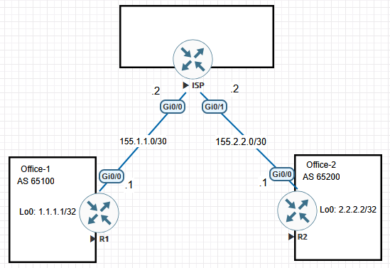

# eBGP Multihop Peering Failure over a Default Route

This EVE-NG lab demonstrates a Cisco IOS and IOS XE behaviour that can make a loopback-to-loopback external BGP (eBGP) session fail even though the two peer addresses are reachable with ICMP. Each office router has a working default route through the same simulated ISP, but neither router initially has a more-specific route to the remote BGP peer.

The failure is deliberately retained in the baseline. The correction is then applied to one side at a time to show which router initiates the TCP connection and why a single more-specific route can be sufficient to establish the session.

The scenario is adapted from [CostiSer's Quiz #4](https://costiser.ro/2013/01/22/quiz-4/) and uses the interfaces shown in the reproduced EVE-NG topology rather than the Serial interfaces in the original diagram.

## Objectives

- Build a three-router transit topology with two private autonomous systems.
- Form an eBGP multihop session between the office routers' loopback addresses.
- Confirm that ICMP reachability alone does not prove that the BGP session can be initiated.
- Compare a default-route-only lookup with a more-specific `/32` route to the peer.
- Identify the TCP initiator and listener from the socket table.
- Demonstrate that one side can initiate the session while the other side returns traffic through its default route.

## Environment and Scope

- Lab platform: EVE-NG
- Virtual network platform: Cisco IOSv
- Software release: not retained in the captured evidence

The ISP is a routed transit device only. It does not participate in the eBGP session between R1 and R2.

## Topology



| Device | Interface | IPv4 address | Purpose |
| --- | --- | --- | --- |
| R1 | `GigabitEthernet0/0` | `155.1.1.1/30` | Office-1 connection to ISP |
| R1 | `Loopback0` | `1.1.1.1/32` | Local BGP peering address |
| ISP | `GigabitEthernet0/0` | `155.1.1.2/30` | Transit connection to R1 |
| ISP | `GigabitEthernet0/1` | `155.2.2.2/30` | Transit connection to R2 |
| R2 | `GigabitEthernet0/0` | `155.2.2.1/30` | Office-2 connection to ISP |
| R2 | `Loopback0` | `2.2.2.2/32` | Local BGP peering address |

The routing intent before the correction is:

- R1 reaches all non-connected destinations through `155.1.1.2`.
- R2 reaches all non-connected destinations through `155.2.2.2`.
- ISP has explicit routes to both office loopbacks so that it can forward between them.
- R1 and R2 do not initially have a more-specific route to each other's loopback.

## Baseline Configuration

The following configuration intentionally creates the failure condition. Platform-generated boilerplate and unused interfaces are omitted.

### R1: Office-1

```cisco
hostname R1
!
no ip domain lookup
ip cef
!
interface GigabitEthernet0/0
 description TO-ISP-Gi0/0
 ip address 155.1.1.1 255.255.255.252
 no shutdown
!
interface Loopback0
 description BGP-PEERING-ADDRESS
 ip address 1.1.1.1 255.255.255.255
!
ip route 0.0.0.0 0.0.0.0 155.1.1.2
!
router bgp 65100
 bgp router-id 1.1.1.1
 bgp log-neighbor-changes
 neighbor 2.2.2.2 remote-as 65200
 neighbor 2.2.2.2 ebgp-multihop 255
 neighbor 2.2.2.2 update-source Loopback0
```

### ISP: transit router

```cisco
hostname ISP
!
no ip domain lookup
ip cef
!
interface GigabitEthernet0/0
 description TO-R1-Gi0/0
 ip address 155.1.1.2 255.255.255.252
 no shutdown
!
interface GigabitEthernet0/1
 description TO-R2-Gi0/0
 ip address 155.2.2.2 255.255.255.252
 no shutdown
!
ip route 1.1.1.1 255.255.255.255 155.1.1.1
ip route 2.2.2.2 255.255.255.255 155.2.2.1
```

The two ISP routes provide transit reachability to the office loopbacks. They do not give R1 or R2 a more-specific route to the remote BGP peer.

### R2: Office-2

```cisco
hostname R2
!
no ip domain lookup
ip cef
!
interface GigabitEthernet0/0
 description TO-ISP-Gi0/1
 ip address 155.2.2.1 255.255.255.252
 no shutdown
!
interface Loopback0
 description BGP-PEERING-ADDRESS
 ip address 2.2.2.2 255.255.255.255
!
ip route 0.0.0.0 0.0.0.0 155.2.2.2
!
router bgp 65200
 bgp router-id 2.2.2.2
 bgp log-neighbor-changes
 neighbor 1.1.1.1 remote-as 65100
 neighbor 1.1.1.1 ebgp-multihop 255
 neighbor 1.1.1.1 update-source Loopback0
```

## Stage 1: Reproduce the Failure

### Verify loopback reachability

From R1:

```cisco
R1#ping 2.2.2.2 source Loopback0
Type escape sequence to abort.
Sending 5, 100-byte ICMP Echos to 2.2.2.2, timeout is 2 seconds:
Packet sent with a source address of 1.1.1.1
!!!!!
Success rate is 100 percent (5/5), round-trip min/avg/max = 1/1/2 ms

R1#traceroute 2.2.2.2 source Loopback0
Type escape sequence to abort.
Tracing the route to 2.2.2.2
VRF info: (vrf in name/id, vrf out name/id)
  1 155.1.1.2 1 msec 1 msec 1 msec
  2 155.2.2.1 2 msec *  2 msec
```

### Inspect the route selected for the BGP peer

On R1:

```cisco
R1#show ip cef 2.2.2.2
0.0.0.0/0
  nexthop 155.1.1.2 GigabitEthernet0/0
```

The recorded CEF lookup resolves through `0.0.0.0/0`; neither office router has a `/32` route to its peer in the baseline configuration.

### Inspect the failed BGP session

Run on both office routers:

```cisco
R1#show ip bgp summary
BGP router identifier 1.1.1.1, local AS number 65100
BGP table version is 1, main routing table version 1

Neighbor        V           AS MsgRcvd MsgSent   TblVer  InQ OutQ Up/Down  State/PfxRcd
2.2.2.2         4        65200       0       0        1    0    0 00:10:41 Idle
```

## Root Cause

R1 and R2 have valid data-plane reachability through their default routes. That is sufficient for sourced ICMP packets to cross the ISP, but [Cisco documents an additional restriction for eBGP multihop](https://www.cisco.com/c/en/us/td/docs/switches/lan/c9000/lyr3-fwd/bgp/bgp-configuration-guide/routing-bgp.html): the session is not established when the only route to the multihop peer is `0.0.0.0/0`.

The distinction is between forwarding a packet and actively opening the BGP transport connection:

1. A ping performs an ordinary route lookup and can follow the default route.
2. The eBGP multihop process checks reachability to the configured peer before initiating TCP.
3. When the peer resolves only through the default route, Cisco IOS or IOS XE does not actively open the multihop session.
4. A more-specific route to the peer allows that router to initiate the TCP connection.
5. As specified by [RFC 4271](https://www.rfc-editor.org/rfc/rfc4271.html), the remote BGP speaker is listening on TCP port 179 and can accept the incoming connection; in this topology, its return traffic can still follow the default route.

This explains why a more-specific route on only one office router can be enough. The router with that route performs the active TCP open, while the other router responds as the passive side of the same TCP connection.

## Stage 2: Let R1 Initiate the Session

Add a host route on R1 only:

```cisco
R1(config)# ip route 2.2.2.2 255.255.255.255 155.1.1.2
```

Wait for the next BGP retry or reset the non-established neighbor in the isolated lab:

```cisco
R1#show ip route 2.2.2.2
Routing entry for 2.2.2.2/32
  Known via "static", distance 1, metric 0
  Routing Descriptor Blocks:
  * 155.1.1.2
      Route metric is 0, traffic share count is 1

R1#show ip bgp summary
BGP router identifier 1.1.1.1, local AS number 65100
BGP table version is 1, main routing table version 1

Neighbor        V           AS MsgRcvd MsgSent   TblVer  InQ OutQ Up/Down  State/PfxRcd
2.2.2.2         4        65200       4       4        1    0    0 00:00:24        0

R1#show tcp brief
TCB       Local Address               Foreign Address             (state)
0D1977C8  1.1.1.1.55554              2.2.2.2.179                 ESTAB
```

The recorded output shows:

- R1 selects the `/32` static route instead of its default route for `2.2.2.2`.
- The BGP session reaches `Established`.
- R1's TCP table shows a local ephemeral port connected to remote TCP port 179.
- R2 accepts the connection on TCP port 179 while retaining the baseline default-route-only configuration toward R1.

## Stage 3: Reverse the Initiator

This stage proves the same behaviour in the opposite direction. First remove R1's host route and clear the existing session so that a previously established TCP connection does not affect the test:

```cisco
R1(config)# no ip route 2.2.2.2 255.255.255.255 155.1.1.2
R1# clear ip bgp 2.2.2.2
```

Add the more-specific route on R2 only:

```cisco
R2(config)# ip route 1.1.1.1 255.255.255.255 155.2.2.2
```

Wait for the retry or reset the non-established neighbor, then verify both ends:

```cisco
R2#show ip route 1.1.1.1
Routing entry for 1.1.1.1/32
  Known via "static", distance 1, metric 0
  Routing Descriptor Blocks:
  * 155.2.2.2
      Route metric is 0, traffic share count is 1

R2#show ip bgp summary
BGP router identifier 2.2.2.2, local AS number 65200
BGP table version is 1, main routing table version 1

Neighbor        V           AS MsgRcvd MsgSent   TblVer  InQ OutQ Up/Down  State/PfxRcd
1.1.1.1         4        65100       4       4        1    0    0 00:00:12        0

R2#show tcp brief
TCB       Local Address               Foreign Address             (state)
0E5DBDF8  2.2.2.2.62704              1.1.1.1.179                 ESTAB
```

The recorded output confirms that R2 now has the route required to initiate the TCP connection. Its local and foreign port values show R2 using an ephemeral source port toward R1 TCP port 179.

## Recommended Final Lab State

One more-specific route demonstrates the behaviour, but configuring reachability on both peers makes the intent explicit and removes dependence on which router happens to initiate the TCP session.

R1:

```cisco
ip route 2.2.2.2 255.255.255.255 155.1.1.2
```

R2:

```cisco
ip route 1.1.1.1 255.255.255.255 155.2.2.2
```

For this two-hop topology, an `ebgp-multihop` TTL of `2` is sufficient. The value `255` is retained in the baseline because it matches the source scenario, but production configurations should use a deliberate hop count and appropriate control-plane protection.

## Troubleshooting Checklist

1. Confirm the physical and line protocols are up on all transit interfaces.
2. Confirm R1 and R2 use different local AS numbers and matching remote AS values.
3. Confirm both neighbor statements use the remote loopback address.
4. Confirm `update-source Loopback0` is present on both peers.
5. Confirm `ebgp-multihop` is configured because the peers are not directly connected.
6. Test the peer address using the local loopback as the source.
7. Inspect the exact route selected for the peer; do not stop after a successful ping.
8. Distinguish `0.0.0.0/0` from a more-specific route in the routing and CEF tables.
9. Inspect TCP endpoints to determine which side initiated the connection.
10. Disable all debugging immediately after collecting the required evidence.

## Rollback

Remove the peer-specific routes to restore the original failure condition:

```cisco
R1(config)# no ip route 2.2.2.2 255.255.255.255 155.1.1.2
R2(config)# no ip route 1.1.1.1 255.255.255.255 155.2.2.2
```

Clear the session if a clean baseline retest is required:

```cisco
R1# clear ip bgp 2.2.2.2
R2# clear ip bgp 1.1.1.1
```

These commands interrupt the lab BGP session and should not be applied casually to a production peer.

## Operational Limitations

- The topology represents an isolated control-plane experiment, not a production Internet edge.
- Both office AS numbers are private and are used only for the lab.
- The ISP uses static host routes solely to provide deterministic transit reachability.
- No prefixes are exchanged after the session forms; the experiment focuses on transport establishment.
- The exact neighbor state and debug text can vary by platform and software release.
- The default-route restriction described here is Cisco IOS and IOS XE behaviour for multihop BGP and should not be generalized to every vendor or network operating system without testing.
- Production eBGP should also consider filtering, authentication, Generalized TTL Security Mechanism (GTSM), maximum-prefix limits, logging, monitoring, and failure detection.

## Key Lessons

- Successful ICMP reachability does not prove that a BGP transport session can be initiated.
- `neighbor ... ebgp-multihop` permits a non-directly connected eBGP peer, but it does not make a default-only route sufficient on Cisco IOS or IOS XE.
- A more-specific route on either R1 or R2 can allow that router to perform the active TCP open.
- The other peer can accept the connection on TCP port 179 and return packets through its default route.
- The routing table, CEF lookup, BGP finite state, and TCP socket table together provide stronger evidence than ping alone.
- Symmetric peer reachability is operationally clearer even when one specific route is enough to establish this lab session.

## References

- [CostiSer: Quiz #4 - BGP over ISP](https://costiser.ro/2013/01/22/quiz-4/)
- [CostiSer: eBGP Peering Not Established over a Default Route](https://costiser.ro/2013/02/02/bgp-over-a-default-route/)
- [Cisco: Troubleshoot BGP Neighborship Connection Issues](https://www.cisco.com/c/en/us/support/docs/ip/border-gateway-protocol-bgp/13752-24.html)
- [Cisco IOS IP Routing: BGP Command Reference - `neighbor ebgp-multihop` and `neighbor update-source`](https://www.cisco.com/c/en/us/td/docs/ios-xml/ios/iproute_bgp/command/irg-cr-book/bgp-m1.html)
- [Cisco IOS XE BGP Configuration Guide: Configuring BGP Neighbors and Peer Groups](https://www.cisco.com/c/en/us/td/docs/switches/lan/c9000/lyr3-fwd/bgp/bgp-configuration-guide/routing-bgp.html)
- [RFC 4271: A Border Gateway Protocol 4 (BGP-4)](https://www.rfc-editor.org/rfc/rfc4271.html)
- [RFC 6996: Autonomous System (AS) Reservation for Private Use](https://www.rfc-editor.org/rfc/rfc6996.html)
