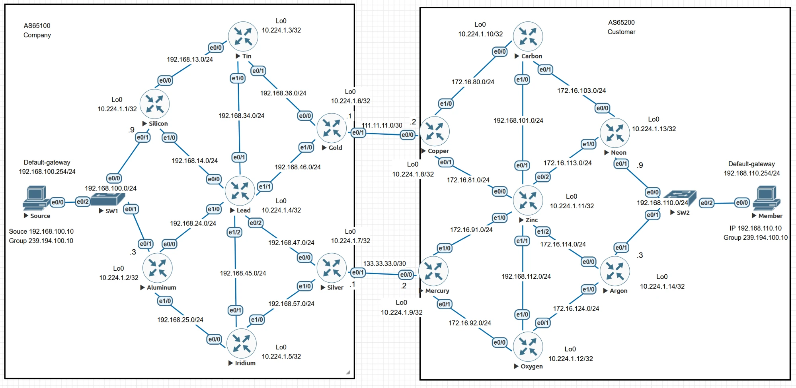

# Inter-Domain Multicast with BSR, MSDP, and MBGP

This EVE-NG lab delivers one multicast stream between two BGP autonomous systems. A source at `192.168.100.10` in AS65100 sends to group `239.194.100.10`, and a receiver at `192.168.110.10` in AS65200 joins the group. Each AS runs its own PIM Sparse Mode domain with its own Bootstrap Router (BSR) and Rendezvous Point (RP). The RPs exchange source information with MSDP, and Multiprotocol BGP (MBGP) provides the inter-domain RPF information.

The scenario is a configuration exercise from Chapter 9, *Scaling IP Multicast Routing*. Every requirement is implemented and verified below with CLI output captured from the running lab.

> [!NOTE]
> All routers and both end hosts run Cisco IOL `L3-ADVENTERPRISEK9-M-15.4-2T`. The two LAN switches run IOL L2 (`i86bi_linux_l2-adventerprisek9-ms.SSA.high_iron_20190423`). The outputs were captured from the device consoles, while live test traffic was flowing. Legend lines in `show ip mroute` and `show ip bgp` output are omitted.

## Scope and Evidence Boundaries

- `Source` and `Member` are IOL routers with `no ip routing`, used as end hosts. `Member` joins the group with `ip igmp join-group`. `Source` generates traffic with a multicast `ping`.
- The exercise assumes that unicast routing already exists. In this lab, OSPF and BGP are built from scratch. Only the prefixes that the multicast design needs are exchanged between the two ASes: the source LAN, the receiver LAN, and the two RP loopbacks.

## Objectives

- Run PIM Sparse Mode in each AS, with a separate BSR and RP per domain.
- Make Iridium and Oxygen the elected BSRs, with Tin and Carbon as the other candidates.
- Make Lead and Zinc the candidate RPs on their `Loopback0` interfaces.
- Keep BSR messages inside each AS.
- Exchange multicast RPF information between the ASes with MBGP.
- Use Gold–Copper as the primary inter-AS path and Silver–Mercury as the backup in both directions.
- Run HSRP on both host LANs, and make Silicon and Neon the HSRP Active router and PIM DR.
- Make the source traffic leave the source LAN through Silicon.
- Peer Lead and Zinc with MSDP, and verify end-to-end delivery from the source to the receiver.

## Topology



### Roles and Loopbacks

| AS | Router | `Loopback0` | Role |
| --- | --- | --- | --- |
| 65100 | Silicon | `10.224.1.1/32` | HSRP Active and PIM DR on the source LAN |
| 65100 | Aluminum | `10.224.1.2/32` | HSRP Standby on the source LAN |
| 65100 | Tin | `10.224.1.3/32` | Candidate BSR, priority 0 |
| 65100 | Lead | `10.224.1.4/32` | Candidate RP, BGP route reflector, MSDP peer |
| 65100 | Iridium | `10.224.1.5/32` | Candidate BSR, priority 255 (elected BSR) |
| 65100 | Gold | `10.224.1.6/32` | Primary border router; eBGP to Copper |
| 65100 | Silver | `10.224.1.7/32` | Backup border router; eBGP to Mercury |
| 65200 | Copper | `10.224.1.8/32` | Primary border router; eBGP to Gold |
| 65200 | Mercury | `10.224.1.9/32` | Backup border router; eBGP to Silver |
| 65200 | Carbon | `10.224.1.10/32` | Candidate BSR, priority 0 |
| 65200 | Zinc | `10.224.1.11/32` | Candidate RP, BGP route reflector, MSDP peer |
| 65200 | Oxygen | `10.224.1.12/32` | Candidate BSR, priority 255 (elected BSR) |
| 65200 | Neon | `10.224.1.13/32` | HSRP Active and PIM DR on the receiver LAN |
| 65200 | Argon | `10.224.1.14/32` | HSRP Standby on the receiver LAN |

### Links

| Subnet | Endpoints |
| --- | --- |
| `192.168.13.0/24` | Silicon `E0/0` (.1) – Tin `E0/0` (.3) |
| `192.168.14.0/24` | Silicon `E1/0` (.1) – Lead `E0/0` (.4) |
| `192.168.24.0/24` | Aluminum `E0/0` (.2) – Lead `E1/0` (.4) |
| `192.168.25.0/24` | Aluminum `E1/0` (.2) – Iridium `E0/0` (.5) |
| `192.168.34.0/24` | Tin `E1/0` (.3) – Lead `E0/1` (.4) |
| `192.168.36.0/24` | Tin `E0/1` (.3) – Gold `E0/0` (.6) |
| `192.168.45.0/24` | Lead `E1/2` (.4) – Iridium `E0/1` (.5) |
| `192.168.46.0/24` | Lead `E1/1` (.4) – Gold `E1/0` (.6) |
| `192.168.47.0/24` | Lead `E0/2` (.4) – Silver `E0/0` (.7) |
| `192.168.57.0/24` | Iridium `E1/0` (.5) – Silver `E1/0` (.7) |
| `111.11.11.0/30` | Gold `E0/1` (.1) – Copper `E0/0` (.2), primary inter-AS link |
| `133.33.33.0/30` | Silver `E0/1` (.1) – Mercury `E0/0` (.2), backup inter-AS link |
| `172.16.80.0/24` | Copper `E1/0` (.8) – Carbon `E0/0` (.10) |
| `172.16.81.0/24` | Copper `E0/1` (.8) – Zinc `E0/0` (.11) |
| `172.16.91.0/24` | Mercury `E1/0` (.9) – Zinc `E1/0` (.11) |
| `172.16.92.0/24` | Mercury `E0/1` (.9) – Oxygen `E0/0` (.12) |
| `172.16.101.0/24` | Carbon `E1/0` (.10) – Zinc `E0/1` (.11) |
| `172.16.103.0/24` | Carbon `E0/1` (.10) – Neon `E0/0` (.13) |
| `172.16.112.0/24` | Zinc `E1/1` (.11) – Oxygen `E1/0` (.12) |
| `172.16.113.0/24` | Zinc `E0/2` (.11) – Neon `E1/0` (.13) |
| `172.16.114.0/24` | Zinc `E1/2` (.11) – Argon `E0/0` (.14) |
| `172.16.124.0/24` | Oxygen `E0/1` (.12) – Argon `E1/0` (.14) |
| `192.168.100.0/24` | Source LAN through SW1: Silicon `E0/1` (.9), Aluminum `E0/1` (.3), Source (.10), HSRP VIP .254 |
| `192.168.110.0/24` | Receiver LAN through SW2: Neon `E0/1` (.9), Argon `E0/1` (.3), Member (.10), HSRP VIP .254 |

## Requirements and Design

| Requirement | Implementation |
| --- | --- |
| PIM Sparse Mode in each domain | `ip multicast-routing` on every router. `ip pim sparse-mode` on every routed interface, on the inter-AS links, and on the `Loopback0` of each BSR or RP candidate. |
| BSR candidates and elected BSR | `ip pim bsr-candidate Loopback0 0` on Tin and Carbon. `ip pim bsr-candidate Loopback0 0 255` on Iridium and Oxygen, so they win the election on priority. |
| Candidate RPs | `ip pim rp-candidate Loopback0` on Lead and Zinc. |
| No BSR messages toward the other AS | `ip pim bsr-border` on all four inter-AS interfaces. |
| Multicast between the domains | PIM on the inter-AS links. The `ipv4 multicast` address family carries the source LAN and the RP loopbacks between the ASes. |
| Primary path Gold–Copper, backup Silver–Mercury | Gold and Copper set LOCAL_PREF 110 on routes received from each other, in both the unicast and multicast address families. Silver and Mercury keep the default LOCAL_PREF of 100. |
| HSRP, with Silicon / Neon as Active and PIM DR | HSRPv2 groups 100 and 101 with VIP `.254`. Silicon and Neon have HSRP priority 101 and PIM DR priority 100. |
| Source traffic through Silicon | A static multicast route on Lead pins the RPF neighbor for `192.168.100.10` to Silicon. |
| MSDP between Lead and Zinc | `ip msdp peer` between the RP loopbacks, sourced from `Loopback0`. |

## Build Steps

The complete final configuration of each device is listed in [Appendix: Final Configurations](#appendix-final-configurations). This section explains each stage and shows a representative excerpt.

### Step 1: Unicast Routing

OSPF process 1 runs in area 0 inside each AS. Router-to-router links use the `point-to-point` network type, and every `Loopback0` is advertised. The inter-AS links are not in OSPF.

```cisco
interface Ethernet0/0
 ip ospf network point-to-point
 ip ospf 1 area 0
!
router ospf 1
 router-id 10.224.1.1
```

Lead and Zinc are the iBGP route reflectors for their ASes. Each accepts dynamic iBGP neighbors from its own loopback range, so the clients only configure one neighbor.

```cisco
! Lead (Zinc is identical with AS 65200 and listen range 10.224.1.8/29)
router bgp 65100
 bgp router-id 10.224.1.4
 bgp listen range 10.224.1.0/29 peer-group Inside
 neighbor Inside peer-group
 neighbor Inside remote-as 65100
 neighbor Inside update-source Loopback0
 address-family ipv4
  neighbor Inside activate
  neighbor Inside route-reflector-client
 address-family ipv4 multicast
  neighbor Inside activate
  neighbor Inside route-reflector-client
```

```cisco
! Every other iBGP router, for example Silicon
router bgp 65100
 bgp router-id 10.224.1.1
 neighbor 10.224.1.4 remote-as 65100
 neighbor 10.224.1.4 update-source Loopback0
 address-family ipv4
  neighbor 10.224.1.4 activate
 address-family ipv4 multicast
  neighbor 10.224.1.4 activate
```

The four border routers run eBGP over the directly connected inter-AS links. They use `next-hop-self` toward their route reflector in both address families. Without it, the external next hops `111.11.11.x` and `133.33.33.x` would have to be resolved inside the AS, and those subnets are not in OSPF.

Only these prefixes cross the AS boundary:

| Prefix | Originated by | Address families |
| --- | --- | --- |
| `10.224.1.4/32` (Lead RP) | Lead | unicast and multicast |
| `10.224.1.11/32` (Zinc RP) | Zinc | unicast and multicast |
| `192.168.100.0/24` (source LAN) | Lead, unicast and multicast; Gold, unicast | unicast and multicast |
| `192.168.110.0/24` (receiver LAN) | Zinc | unicast |

The unicast routes give the MSDP peers loopback-to-loopback reachability and give the hosts bidirectional reachability. The multicast routes provide the RPF information in AS65200, which has no IGP route to the source.

### Step 2: PIM Sparse Mode

Enable multicast routing, then run PIM Sparse Mode on every routed interface and on the inter-AS links. Also enable PIM on the `Loopback0` of each BSR and RP candidate, because those addresses are advertised in PIM messages.

```cisco
ip multicast-routing
!
interface Ethernet0/0
 ip pim sparse-mode
```

### Step 3: BSR and Candidate RP

```cisco
! Tin and Carbon
ip pim bsr-candidate Loopback0 0
!
! Iridium and Oxygen (priority 255 wins the BSR election)
ip pim bsr-candidate Loopback0 0 255
!
! Lead and Zinc
ip pim rp-candidate Loopback0
```

### Step 4: BSR Domain Boundary

`ip pim bsr-border` stops BSR messages from being sent or accepted on an interface, while normal PIM operation continues on it. Apply it to all four inter-AS interfaces: Gold `E0/1`, Silver `E0/1`, Copper `E0/0`, and Mercury `E0/0`.

```cisco
! Gold
interface Ethernet0/1
 ip address 111.11.11.1 255.255.255.252
 ip pim bsr-border
 ip pim sparse-mode
```

### Step 5: Primary and Backup Inter-AS Path

Each primary border router raises LOCAL_PREF to 110 on everything it learns from the other AS's primary border router. The backup routers keep the default of 100. Because LOCAL_PREF is propagated through iBGP, every router in the AS prefers the primary exit, and the backup path remains in the table.

The policy is applied in **both** address families. Inside AS65200, RPF toward the source uses the `ipv4 multicast` table, so a unicast-only policy would not control the multicast path.

```cisco
! Gold (Copper is identical with route-map PRI_LOC toward 111.11.11.1)
route-map PRE_LOC permit 10
 set local-preference 110
!
router bgp 65100
 address-family ipv4
  neighbor 111.11.11.2 route-map PRE_LOC in
 address-family ipv4 multicast
  neighbor 111.11.11.2 route-map PRE_LOC in
```

An inbound policy only affects updates received after it was applied. Refresh the routes already received from the peer:

```cisco
Gold# clear ip bgp 111.11.11.2 soft in
Gold# clear bgp ipv4 multicast 111.11.11.2 soft in
```

### Step 6: HSRP, PIM DR, and the Source Path

On each host LAN, the router that should carry the traffic gets the higher HSRP priority and the higher PIM DR priority. The hosts use the HSRP virtual IP as their default gateway.

```cisco
! Silicon (Neon uses group 101 and 192.168.110.254)
interface Ethernet0/1
 ip address 192.168.100.9 255.255.255.0
 ip pim dr-priority 100
 ip pim sparse-mode
 standby version 2
 standby 100 ip 192.168.100.254
 standby 100 priority 101
 standby 100 preempt delay minimum 5
```

HSRP and the PIM DR election do not decide which first-hop router forwards the source's traffic onto the shortest-path tree. That router is chosen by the RPF lookups of the downstream routers. Lead has equal-cost OSPF routes to `192.168.100.0/24` through Silicon (`192.168.14.1`) and Aluminum (`192.168.24.2`). With equal-cost paths, PIM selects the RPF neighbor with the highest IP address, which is Aluminum. Advertising `192.168.100.0` in Lead's own `ipv4 multicast` address family does not help: a locally originated BGP route has administrative distance 200 and loses to OSPF's 110. A static multicast route, with administrative distance 0, fixes the RPF neighbor:

```cisco
! Lead
ip mroute 192.168.100.10 255.255.255.255 192.168.14.1
```

### Step 7: MSDP Between the RPs

```cisco
! Lead
ip msdp peer 10.224.1.11 connect-source Loopback0
ip msdp cache-sa-state
!
! Zinc
ip msdp peer 10.224.1.4 connect-source Loopback0
ip msdp cache-sa-state
```

The MSDP peers are the RPs themselves, so the SA messages that Zinc receives come directly from the originating RP and pass the MSDP peer-RPF check.

### Step 8: End Hosts

```cisco
! Source
no ip routing
interface Ethernet0/0
 ip address 192.168.100.10 255.255.255.0
ip default-gateway 192.168.100.254
!
! Member
no ip routing
interface Ethernet0/0
 ip address 192.168.110.10 255.255.255.0
 ip igmp join-group 239.194.100.10
ip default-gateway 192.168.110.254
```

## Verification

The test traffic was generated from Source, and every echo request was answered by the receiver:

```text
Source# ping 239.194.100.10 repeat 20
Sending 20, 100-byte ICMP Echos to 239.194.100.10, timeout is 2 seconds:

Reply to request 0 from 192.168.110.10, 31 ms
Reply to request 1 from 192.168.110.10, 33 ms
Reply to request 2 from 192.168.110.10, 2 ms
...
Reply to request 19 from 192.168.110.10, 1 ms
```

### BSR Election and RP Mapping in AS65100

Iridium is the BSR, and Tin is a standby candidate:

```text
Iridium# show ip pim bsr-router
PIMv2 Bootstrap information
This system is the Bootstrap Router (BSR)
  BSR address: 10.224.1.5 (?)
  Uptime:      05:30:48, BSR Priority: 255, Hash mask length: 0
  Next bootstrap message in 00:00:29

Tin# show ip pim bsr-router
PIMv2 Bootstrap information
  BSR address: 10.224.1.5 (?)
  Uptime:      05:29:46, BSR Priority: 255, Hash mask length: 0
  Expires:     00:01:39
This system is a candidate BSR
  Candidate BSR address: 10.224.1.3, priority: 0, hash mask length: 0
```

Lead is the RP for `224.0.0.0/4`, learned through the bootstrap message from Iridium:

```text
Lead# show ip pim rp mapping
PIM Group-to-RP Mappings
This system is a candidate RP (v2)

Group(s) 224.0.0.0/4
  RP 10.224.1.4 (?), v2
    Info source: 10.224.1.5 (?), via bootstrap, priority 0, holdtime 150
         Uptime: 05:28:32, expires: 00:01:57
```

### BSR Election and RP Mapping in AS65200

```text
Oxygen# show ip pim bsr-router
PIMv2 Bootstrap information
This system is the Bootstrap Router (BSR)
  BSR address: 10.224.1.12 (?)
  Uptime:      05:14:50, BSR Priority: 255, Hash mask length: 0
  Next bootstrap message in 00:00:15

Carbon# show ip pim bsr-router
PIMv2 Bootstrap information
  BSR address: 10.224.1.12 (?)
  Uptime:      05:13:50, BSR Priority: 255, Hash mask length: 0
  Expires:     00:01:25
This system is a candidate BSR
  Candidate BSR address: 10.224.1.10, priority: 0, hash mask length: 0

Zinc# show ip pim rp mapping
PIM Group-to-RP Mappings
This system is a candidate RP (v2)

Group(s) 224.0.0.0/4
  RP 10.224.1.11 (?), v2
    Info source: 10.224.1.12 (?), via bootstrap, priority 0, holdtime 150
         Uptime: 05:13:48, expires: 00:01:42
```

### BSR Boundary

PIM is running across the inter-AS links. Gold, for example, has Copper as a PIM neighbor on `E0/1`:

```text
Gold# show ip pim neighbor
Neighbor          Interface                Uptime/Expires    Ver   DR
Address                                                            Prio/Mode
192.168.36.3      Ethernet0/0              05:27:26/00:01:35 v2    1 / S P G
192.168.46.4      Ethernet1/0              05:27:26/00:01:37 v2    1 / S P G
111.11.11.2       Ethernet0/1              01:16:16/00:01:44 v2    1 / DR S P G
```

Even so, each border router knows only the BSR and RP of its own domain. The other AS's BSR messages are not crossing the boundary:

```text
Gold# show ip pim rp mapping
Group(s) 224.0.0.0/4
  RP 10.224.1.4 (?), v2
    Info source: 10.224.1.5 (?), via bootstrap, priority 0, holdtime 150

Copper# show ip pim rp mapping
Group(s) 224.0.0.0/4
  RP 10.224.1.11 (?), v2
    Info source: 10.224.1.12 (?), via bootstrap, priority 0, holdtime 150

Copper# show ip pim bsr-router
PIMv2 Bootstrap information
  BSR address: 10.224.1.12 (?)
```

The same result was observed on every router: all routers in AS65100 map the RP to `10.224.1.4` with BSR `10.224.1.5`, and all routers in AS65200 map it to `10.224.1.11` with BSR `10.224.1.12`.

### HSRP and PIM DR

```text
Silicon# show standby brief
Interface   Grp  Pri P State   Active          Standby         Virtual IP
Et0/1       100  101 P Active  local           192.168.100.3   192.168.100.254

Silicon# show ip pim interface Ethernet0/1
Address          Interface                Ver/   Nbr    Query  DR     DR
                                          Mode   Count  Intvl  Prior
192.168.100.9    Ethernet0/1              v2/S   1      30     100    192.168.100.9

Neon# show standby brief
Interface   Grp  Pri P State   Active          Standby         Virtual IP
Et0/1       101  101 P Active  local           192.168.110.3   192.168.110.254

Neon# show ip pim interface Ethernet0/1
Address          Interface                Ver/   Nbr    Query  DR     DR
                                          Mode   Count  Intvl  Prior
192.168.110.9    Ethernet0/1              v2/S   1      30     100    192.168.110.9
```

Aluminum and Argon are the HSRP Standby routers, and both see the `.9` router as the DR.

### Source Traffic Leaves Through Silicon

Lead's RPF neighbor for the source is Silicon, selected by the static mroute:

```text
Lead# show ip rpf 192.168.100.10
RPF information for ? (192.168.100.10)
  RPF interface: Ethernet0/0
  RPF neighbor: ? (192.168.14.1)
  RPF route/mask: 192.168.100.10/32
  RPF type: multicast (static)
```

Silicon forwards the `(S,G)` traffic toward Lead. Aluminum's `(S,G)` entry is pruned (`P`) and has an empty outgoing interface list:

```text
Silicon# show ip mroute 239.194.100.10
(192.168.100.10, 239.194.100.10), 00:00:43/00:02:16, flags: FT
  Incoming interface: Ethernet0/1, RPF nbr 0.0.0.0
  Outgoing interface list:
    Ethernet1/0, Forward/Sparse, 00:00:43/00:02:46

Aluminum# show ip mroute 239.194.100.10
(192.168.100.10, 239.194.100.10), 00:00:43/00:02:16, flags: PT
  Incoming interface: Ethernet0/1, RPF nbr 0.0.0.0
  Outgoing interface list: Null
```

### Primary and Backup Paths in BGP

In AS65100, Silver has two paths to Zinc's RP loopback, in both address families. The iBGP path through Gold wins on LOCAL_PREF 110. Silver's own eBGP path through Mercury remains as the backup:

```text
Silver# show bgp ipv4 multicast 10.224.1.11
BGP routing table entry for 10.224.1.11/32, version 5
Paths: (2 available, best #1, table 8000)
  65200
    10.224.1.6 (metric 21) from 10.224.1.4 (10.224.1.4)
      Origin IGP, metric 0, localpref 110, valid, internal, best
      Originator: 10.224.1.6, Cluster list: 10.224.1.4
  65200
    133.33.33.2 from 133.33.33.2 (10.224.1.9)
      Origin IGP, localpref 100, valid, external
```

In AS65200, Mercury likewise prefers Copper's path to the source LAN over its own eBGP path through Silver:

```text
Mercury# show bgp ipv4 multicast 192.168.100.0
BGP routing table entry for 192.168.100.0/24, version 6
Paths: (2 available, best #1, table 8000)
  65100
    10.224.1.8 (metric 21) from 10.224.1.11 (10.224.1.11)
      Origin IGP, metric 0, localpref 110, valid, internal, best
      Originator: 10.224.1.8, Cluster list: 10.224.1.11
  65100
    133.33.33.1 from 133.33.33.1 (10.224.1.7)
      Origin IGP, localpref 100, valid, external
```

The unicast tables show the same result: `show ip bgp 10.224.1.11` on Silver and `show ip bgp 192.168.100.0` on Mercury both select the LOCAL_PREF 110 path. Every router in AS65200 performs its RPF lookup for the source in the MBGP table, and each lookup points toward Copper:

```text
Zinc# show ip rpf 192.168.100.10
  RPF interface: Ethernet0/0
  RPF neighbor: ? (172.16.81.8)
  RPF route/mask: 192.168.100.0/24
  RPF type: multicast (bgp 65200)

Mercury# show ip rpf 192.168.100.10
  RPF interface: Ethernet1/0
  RPF neighbor: ? (172.16.91.11)
  RPF route/mask: 192.168.100.0/24
  RPF type: multicast (bgp 65200)
```

### MSDP

The MSDP session between the two RPs is up:

```text
Lead# show ip msdp summary
Peer Address     AS    State    Uptime/  Reset SA    Peer Name
                                Downtime Count Count
10.224.1.11      65200 Up       01:32:06 0     0     ?
```

Zinc learned the source through an SA message from Lead:

```text
Zinc# show ip msdp sa-cache
MSDP Source-Active Cache - 5 entries
(192.168.14.4, 239.194.100.10), RP 10.224.1.4, MBGP/AS 65100, 00:06:58/00:01:59, Peer 10.224.1.4
(192.168.45.4, 239.194.100.10), RP 10.224.1.4, MBGP/AS 65100, 00:06:58/00:01:59, Peer 10.224.1.4
(192.168.46.4, 239.194.100.10), RP 10.224.1.4, MBGP/AS 65100, 00:06:58/00:01:59, Peer 10.224.1.4
(192.168.47.4, 239.194.100.10), RP 10.224.1.4, MBGP/AS 65100, 00:06:58/00:01:59, Peer 10.224.1.4
(192.168.100.10, 239.194.100.10), RP 10.224.1.4, MBGP/AS 65100, 00:10:06/00:05:41, Peer 10.224.1.4
```

The relevant entry is `(192.168.100.10, 239.194.100.10)`. The other four sources are Lead's own interface addresses, left by an earlier test ping sent from Lead itself. They are not part of the exercise traffic and expire on their own.

### End-to-End Multicast Path

The receiver's membership is present on both receiver-LAN routers:

```text
Neon# show ip igmp groups 239.194.100.10
IGMP Connected Group Membership
Group Address    Interface                Uptime    Expires   Last Reporter   Group Accounted
239.194.100.10   Ethernet0/1              05:11:49  00:02:49  192.168.110.10
```

The `(S,G)` entries along the primary path, captured during the test, are below. The `T` flag shows that each router is forwarding the traffic on the shortest-path tree:

```text
Lead# show ip mroute 239.194.100.10
(192.168.100.10, 239.194.100.10), 00:00:43/00:02:16, flags: TA
  Incoming interface: Ethernet0/0, RPF nbr 192.168.14.1, Mroute
  Outgoing interface list:
    Ethernet1/1, Forward/Sparse, 00:00:43/00:02:46

Gold# show ip mroute 239.194.100.10
(192.168.100.10, 239.194.100.10), 00:00:43/00:02:16, flags: T
  Incoming interface: Ethernet1/0, RPF nbr 192.168.46.4
  Outgoing interface list:
    Ethernet0/1, Forward/Sparse, 00:00:43/00:02:46

Copper# show ip mroute 239.194.100.10
(192.168.100.10, 239.194.100.10), 00:00:46/00:02:13, flags: T
  Incoming interface: Ethernet0/0, RPF nbr 111.11.11.1, Mbgp
  Outgoing interface list:
    Ethernet0/1, Forward/Sparse, 00:00:46/00:02:43

Zinc# show ip mroute 239.194.100.10
(*, 239.194.100.10), 05:11:48/00:03:22, RP 10.224.1.11, flags: S
  Incoming interface: Null, RPF nbr 0.0.0.0
  Outgoing interface list:
    Ethernet0/2, Forward/Sparse, 05:11:48/00:03:22

(192.168.100.10, 239.194.100.10), 00:00:46/00:02:13, flags: MT
  Incoming interface: Ethernet0/0, RPF nbr 172.16.81.8, Mbgp
  Outgoing interface list:
    Ethernet0/2, Forward/Sparse, 00:00:46/00:03:22

Neon# show ip mroute 239.194.100.10
(*, 239.194.100.10), 05:11:49/stopped, RP 10.224.1.11, flags: SJC
  Incoming interface: Ethernet1/0, RPF nbr 172.16.113.11
  Outgoing interface list:
    Ethernet0/1, Forward/Sparse, 05:11:49/00:02:49

(192.168.100.10, 239.194.100.10), 00:00:46/00:02:13, flags: JT
  Incoming interface: Ethernet1/0, RPF nbr 172.16.113.11, Mbgp
  Outgoing interface list:
    Ethernet0/1, Forward/Sparse, 00:00:46/00:02:49
```

Copper, Zinc, and Neon mark their RPF information as `Mbgp`, and Zinc marks its `(S,G)` entry with `M`, because it was created from the MSDP SA. Argon, the non-DR router on the receiver LAN, has only a pruned `(*,G)` entry. Neither backup border router has any state for the group:

```text
Argon# show ip mroute 239.194.100.10
(*, 239.194.100.10), 05:12:14/00:02:49, RP 10.224.1.11, flags: SP
  Incoming interface: Ethernet0/0, RPF nbr 172.16.114.11
  Outgoing interface list: Null

Silver# show ip mroute 239.194.100.10
Group 239.194.100.10 not found

Mercury# show ip mroute 239.194.100.10
Group 239.194.100.10 not found
```

The packet counters confirm that the source-tree traffic crossed every primary-path hop:

| Router | `(S,G)` packets forwarded |
| --- | --- |
| Silicon | 20 |
| Lead | 19 |
| Gold | 19 |
| Copper | 19 |
| Zinc | 19 |
| Neon | 20 |

The resulting path is:

```text
Source -> SW1 -> Silicon E0/1 -> Silicon E1/0 -> Lead E0/0 -> Lead E1/1 -> Gold E1/0
       -> Gold E0/1 == 111.11.11.0/30 ==> Copper E0/0 -> Copper E0/1 -> Zinc E0/0
       -> Zinc E0/2 -> Neon E1/0 -> Neon E0/1 -> SW2 -> Member
```

## Conclusions

The lab meets every requirement of the exercise:

- Each AS is a separate PIM-SM domain. Iridium and Oxygen are the elected BSRs, and Lead and Zinc are the RPs. `ip pim bsr-border` keeps BSR messages inside each AS even though PIM runs across both inter-AS links.
- MSDP between Lead and Zinc carries the source `192.168.100.10` from AS65100 to AS65200. MBGP gives AS65200 the RPF information it needs to join the shortest-path tree back to the source.
- LOCAL_PREF 110, set on the Gold–Copper session in both address families, makes Gold–Copper the primary path in both directions. The Silver–Mercury paths remain in the BGP tables as backups.
- Silicon and Neon are the HSRP Active routers and PIM DRs. A static mroute on Lead makes the source traffic leave the source LAN through Silicon.
- All 20 multicast echo requests from Source were answered by Member, and the `(S,G)` counters show the traffic on every hop of the primary path.

## Appendix: Final Configurations

These are the relevant parts of each device's running configuration, captured on 30 October 2026. Interface descriptions, unused shut-down interfaces, and platform boilerplate are omitted.

### Silicon
```cisco
hostname Silicon
ip multicast-routing
interface Loopback0
 ip address 10.224.1.1 255.255.255.255
 ip ospf 1 area 0
!
interface Ethernet0/0
 ip address 192.168.13.1 255.255.255.0
 ip pim sparse-mode
 ip ospf network point-to-point
 ip ospf 1 area 0
!
interface Ethernet0/1
 ip address 192.168.100.9 255.255.255.0
 ip pim dr-priority 100
 ip pim sparse-mode
 standby version 2
 standby 100 ip 192.168.100.254
 standby 100 priority 101
 standby 100 preempt delay minimum 5
 ip ospf 1 area 0
!
interface Ethernet1/0
 ip address 192.168.14.1 255.255.255.0
 ip pim sparse-mode
 ip ospf network point-to-point
 ip ospf 1 area 0
!
router ospf 1
 router-id 10.224.1.1
!
router bgp 65100
 bgp router-id 10.224.1.1
 bgp log-neighbor-changes
 neighbor 10.224.1.4 remote-as 65100
 neighbor 10.224.1.4 update-source Loopback0
 address-family ipv4
  neighbor 10.224.1.4 activate
 exit-address-family
 address-family ipv4 multicast
  neighbor 10.224.1.4 activate
 exit-address-family
!
```

### Aluminum
```cisco
hostname Aluminum
ip multicast-routing
interface Loopback0
 ip address 10.224.1.2 255.255.255.255
 ip ospf 1 area 0
!
interface Ethernet0/0
 ip address 192.168.24.2 255.255.255.0
 ip pim sparse-mode
 ip ospf network point-to-point
 ip ospf 1 area 0
!
interface Ethernet0/1
 ip address 192.168.100.3 255.255.255.0
 ip pim sparse-mode
 standby version 2
 standby 100 ip 192.168.100.254
 standby 100 preempt delay minimum 5
 ip ospf 1 area 0
!
interface Ethernet1/0
 ip address 192.168.25.2 255.255.255.0
 ip pim sparse-mode
 ip ospf network point-to-point
 ip ospf 1 area 0
!
router ospf 1
 router-id 10.224.1.2
!
router bgp 65100
 bgp router-id 10.224.1.2
 bgp log-neighbor-changes
 neighbor 10.224.1.4 remote-as 65100
 neighbor 10.224.1.4 update-source Loopback0
 address-family ipv4
  neighbor 10.224.1.4 activate
 exit-address-family
 address-family ipv4 multicast
  neighbor 10.224.1.4 activate
 exit-address-family
!
```

### Tin
```cisco
hostname Tin
ip multicast-routing
interface Loopback0
 ip address 10.224.1.3 255.255.255.255
 ip pim sparse-mode
 ip ospf 1 area 0
!
interface Ethernet0/0
 ip address 192.168.13.3 255.255.255.0
 ip pim sparse-mode
 ip ospf network point-to-point
 ip ospf 1 area 0
!
interface Ethernet0/1
 ip address 192.168.36.3 255.255.255.0
 ip pim sparse-mode
 ip ospf network point-to-point
 ip ospf 1 area 0
!
interface Ethernet1/0
 ip address 192.168.34.3 255.255.255.0
 ip pim sparse-mode
 ip ospf network point-to-point
 ip ospf 1 area 0
!
router ospf 1
 router-id 10.224.1.3
!
router bgp 65100
 bgp router-id 10.224.1.3
 bgp log-neighbor-changes
 neighbor 10.224.1.4 remote-as 65100
 neighbor 10.224.1.4 update-source Loopback0
 address-family ipv4
  neighbor 10.224.1.4 activate
 exit-address-family
 address-family ipv4 multicast
  neighbor 10.224.1.4 activate
 exit-address-family
!
ip pim bsr-candidate Loopback0 0
```

### Lead
```cisco
hostname Lead
ip multicast-routing
interface Loopback0
 ip address 10.224.1.4 255.255.255.255
 ip pim sparse-mode
 ip ospf 1 area 0
!
interface Ethernet0/0
 ip address 192.168.14.4 255.255.255.0
 ip pim sparse-mode
 ip ospf network point-to-point
 ip ospf 1 area 0
!
interface Ethernet0/1
 ip address 192.168.34.4 255.255.255.0
 ip pim sparse-mode
 ip ospf network point-to-point
 ip ospf 1 area 0
!
interface Ethernet0/2
 ip address 192.168.47.4 255.255.255.0
 ip pim sparse-mode
 ip ospf network point-to-point
 ip ospf 1 area 0
!
interface Ethernet1/0
 ip address 192.168.24.4 255.255.255.0
 ip pim sparse-mode
 ip ospf network point-to-point
 ip ospf 1 area 0
!
interface Ethernet1/1
 ip address 192.168.46.4 255.255.255.0
 ip pim sparse-mode
 ip ospf network point-to-point
 ip ospf 1 area 0
!
interface Ethernet1/2
 ip address 192.168.45.4 255.255.255.0
 ip pim sparse-mode
 ip ospf network point-to-point
 ip ospf 1 area 0
!
router ospf 1
 router-id 10.224.1.4
!
router bgp 65100
 bgp router-id 10.224.1.4
 bgp log-neighbor-changes
 bgp listen range 10.224.1.0/29 peer-group Inside
 neighbor Inside peer-group
 neighbor Inside remote-as 65100
 neighbor Inside update-source Loopback0
 address-family ipv4
  network 10.224.1.4 mask 255.255.255.255
  network 192.168.100.0
  neighbor Inside activate
  neighbor Inside route-reflector-client
 exit-address-family
 address-family ipv4 multicast
  network 10.224.1.4 mask 255.255.255.255
  network 192.168.100.0
  neighbor Inside activate
  neighbor Inside route-reflector-client
 exit-address-family
!
ip pim rp-candidate Loopback0
ip mroute 192.168.100.10 255.255.255.255 192.168.14.1
ip msdp peer 10.224.1.11 connect-source Loopback0
ip msdp cache-sa-state
```

### Iridium
```cisco
hostname Iridium
ip multicast-routing
interface Loopback0
 ip address 10.224.1.5 255.255.255.255
 ip pim sparse-mode
 ip ospf 1 area 0
!
interface Ethernet0/0
 ip address 192.168.25.5 255.255.255.0
 ip pim sparse-mode
 ip ospf network point-to-point
 ip ospf 1 area 0
!
interface Ethernet0/1
 ip address 192.168.45.5 255.255.255.0
 ip pim sparse-mode
 ip ospf network point-to-point
 ip ospf 1 area 0
!
interface Ethernet1/0
 ip address 192.168.57.5 255.255.255.0
 ip pim sparse-mode
 ip ospf network point-to-point
 ip ospf 1 area 0
!
router ospf 1
 router-id 10.224.1.5
!
router bgp 65100
 bgp router-id 10.224.1.5
 bgp log-neighbor-changes
 neighbor 10.224.1.4 remote-as 65100
 neighbor 10.224.1.4 update-source Loopback0
 address-family ipv4
  neighbor 10.224.1.4 activate
 exit-address-family
 address-family ipv4 multicast
  neighbor 10.224.1.4 activate
 exit-address-family
!
ip pim bsr-candidate Loopback0 0 255
```

### Gold
```cisco
hostname Gold
ip multicast-routing
interface Loopback0
 ip address 10.224.1.6 255.255.255.255
 ip ospf 1 area 0
!
interface Ethernet0/0
 ip address 192.168.36.6 255.255.255.0
 ip pim sparse-mode
 ip ospf network point-to-point
 ip ospf 1 area 0
!
interface Ethernet0/1
 ip address 111.11.11.1 255.255.255.252
 ip pim bsr-border
 ip pim sparse-mode
!
interface Ethernet1/0
 ip address 192.168.46.6 255.255.255.0
 ip pim sparse-mode
 ip ospf network point-to-point
 ip ospf 1 area 0
!
router ospf 1
 router-id 10.224.1.6
!
router bgp 65100
 bgp router-id 10.224.1.6
 bgp log-neighbor-changes
 neighbor 10.224.1.4 remote-as 65100
 neighbor 10.224.1.4 update-source Loopback0
 neighbor 111.11.11.2 remote-as 65200
 address-family ipv4
  network 192.168.100.0
  neighbor 10.224.1.4 activate
  neighbor 10.224.1.4 next-hop-self
  neighbor 111.11.11.2 activate
  neighbor 111.11.11.2 route-map PRE_LOC in
 exit-address-family
 address-family ipv4 multicast
  neighbor 10.224.1.4 activate
  neighbor 10.224.1.4 next-hop-self
  neighbor 111.11.11.2 activate
  neighbor 111.11.11.2 route-map PRE_LOC in
 exit-address-family
!
route-map PRE_LOC permit 10
 set local-preference 110
!
```

### Silver

An unused, empty `route-map PRE_LOC` left on Silver from an earlier attempt is omitted.

```cisco
hostname Silver
ip multicast-routing
interface Loopback0
 ip address 10.224.1.7 255.255.255.255
 ip ospf 1 area 0
!
interface Ethernet0/0
 ip address 192.168.47.7 255.255.255.0
 ip pim sparse-mode
 ip ospf network point-to-point
 ip ospf 1 area 0
!
interface Ethernet0/1
 ip address 133.33.33.1 255.255.255.252
 ip pim bsr-border
 ip pim sparse-mode
!
interface Ethernet1/0
 ip address 192.168.57.7 255.255.255.0
 ip pim sparse-mode
 ip ospf network point-to-point
 ip ospf 1 area 0
!
router ospf 1
 router-id 10.224.1.7
!
router bgp 65100
 bgp router-id 10.224.1.7
 bgp log-neighbor-changes
 neighbor 10.224.1.4 remote-as 65100
 neighbor 10.224.1.4 update-source Loopback0
 neighbor 133.33.33.2 remote-as 65200
 address-family ipv4
  neighbor 10.224.1.4 activate
  neighbor 10.224.1.4 next-hop-self
  neighbor 133.33.33.2 activate
 exit-address-family
 address-family ipv4 multicast
  neighbor 10.224.1.4 activate
  neighbor 10.224.1.4 next-hop-self
  neighbor 133.33.33.2 activate
 exit-address-family
!
```

### Copper
```cisco
hostname Copper
ip multicast-routing
interface Loopback0
 ip address 10.224.1.8 255.255.255.255
 ip ospf 1 area 0
!
interface Ethernet0/0
 ip address 111.11.11.2 255.255.255.252
 ip pim bsr-border
 ip pim sparse-mode
!
interface Ethernet0/1
 ip address 172.16.81.8 255.255.255.0
 ip pim sparse-mode
 ip ospf network point-to-point
 ip ospf 1 area 0
!
interface Ethernet1/0
 ip address 172.16.80.8 255.255.255.0
 ip pim sparse-mode
 ip ospf network point-to-point
 ip ospf 1 area 0
!
router ospf 1
 router-id 10.224.1.8
!
router bgp 65200
 bgp router-id 10.224.1.8
 bgp log-neighbor-changes
 neighbor 10.224.1.11 remote-as 65200
 neighbor 10.224.1.11 update-source Loopback0
 neighbor 111.11.11.1 remote-as 65100
 address-family ipv4
  neighbor 10.224.1.11 activate
  neighbor 10.224.1.11 next-hop-self
  neighbor 111.11.11.1 activate
  neighbor 111.11.11.1 route-map PRI_LOC in
 exit-address-family
 address-family ipv4 multicast
  neighbor 10.224.1.11 activate
  neighbor 10.224.1.11 next-hop-self
  neighbor 111.11.11.1 activate
  neighbor 111.11.11.1 route-map PRI_LOC in
 exit-address-family
!
route-map PRI_LOC permit 10
 set local-preference 110
!
```

### Mercury
```cisco
hostname Mercury
ip multicast-routing
interface Loopback0
 ip address 10.224.1.9 255.255.255.255
 ip ospf 1 area 0
!
interface Ethernet0/0
 ip address 133.33.33.2 255.255.255.252
 ip pim bsr-border
 ip pim sparse-mode
!
interface Ethernet0/1
 ip address 172.16.92.9 255.255.255.0
 ip pim sparse-mode
 ip ospf network point-to-point
 ip ospf 1 area 0
!
interface Ethernet1/0
 ip address 172.16.91.9 255.255.255.0
 ip pim sparse-mode
 ip ospf network point-to-point
 ip ospf 1 area 0
!
router ospf 1
 router-id 10.224.1.9
!
router bgp 65200
 bgp router-id 10.224.1.9
 bgp log-neighbor-changes
 neighbor 10.224.1.11 remote-as 65200
 neighbor 10.224.1.11 update-source Loopback0
 neighbor 133.33.33.1 remote-as 65100
 address-family ipv4
  neighbor 10.224.1.11 activate
  neighbor 10.224.1.11 next-hop-self
  neighbor 133.33.33.1 activate
 exit-address-family
 address-family ipv4 multicast
  neighbor 10.224.1.11 activate
  neighbor 10.224.1.11 next-hop-self
  neighbor 133.33.33.1 activate
 exit-address-family
!
```

### Carbon
```cisco
hostname Carbon
ip multicast-routing
interface Loopback0
 ip address 10.224.1.10 255.255.255.255
 ip pim sparse-mode
 ip ospf 1 area 0
!
interface Ethernet0/0
 ip address 172.16.80.10 255.255.255.0
 ip pim sparse-mode
 ip ospf network point-to-point
 ip ospf 1 area 0
!
interface Ethernet0/1
 ip address 172.16.103.10 255.255.255.0
 ip pim sparse-mode
 ip ospf network point-to-point
 ip ospf 1 area 0
!
interface Ethernet1/0
 ip address 172.16.101.10 255.255.255.0
 ip pim sparse-mode
 ip ospf network point-to-point
 ip ospf 1 area 0
!
router ospf 1
 router-id 10.224.1.10
!
router bgp 65200
 bgp router-id 10.224.1.10
 bgp log-neighbor-changes
 neighbor 10.224.1.11 remote-as 65200
 neighbor 10.224.1.11 update-source Loopback0
 address-family ipv4
  neighbor 10.224.1.11 activate
 exit-address-family
 address-family ipv4 multicast
  neighbor 10.224.1.11 activate
 exit-address-family
!
ip pim bsr-candidate Loopback0 0
```

### Zinc
```cisco
hostname Zinc
ip multicast-routing
interface Loopback0
 ip address 10.224.1.11 255.255.255.255
 ip pim sparse-mode
 ip ospf 1 area 0
!
interface Ethernet0/0
 ip address 172.16.81.11 255.255.255.0
 ip pim sparse-mode
 ip ospf network point-to-point
 ip ospf 1 area 0
!
interface Ethernet0/1
 ip address 172.16.101.11 255.255.255.0
 ip pim sparse-mode
 ip ospf network point-to-point
 ip ospf 1 area 0
!
interface Ethernet0/2
 ip address 172.16.113.11 255.255.255.0
 ip pim sparse-mode
 ip ospf network point-to-point
 ip ospf 1 area 0
!
interface Ethernet1/0
 ip address 172.16.91.11 255.255.255.0
 ip pim sparse-mode
 ip ospf network point-to-point
 ip ospf 1 area 0
!
interface Ethernet1/1
 ip address 172.16.112.11 255.255.255.0
 ip pim sparse-mode
 ip ospf network point-to-point
 ip ospf 1 area 0
!
interface Ethernet1/2
 ip address 172.16.114.11 255.255.255.0
 ip pim sparse-mode
 ip ospf network point-to-point
 ip ospf 1 area 0
!
router ospf 1
 router-id 10.224.1.11
!
router bgp 65200
 bgp router-id 10.224.1.11
 bgp log-neighbor-changes
 bgp listen range 10.224.1.8/29 peer-group Inside
 neighbor Inside peer-group
 neighbor Inside remote-as 65200
 neighbor Inside update-source Loopback0
 address-family ipv4
  network 10.224.1.11 mask 255.255.255.255
  network 192.168.110.0
  neighbor Inside activate
  neighbor Inside route-reflector-client
 exit-address-family
 address-family ipv4 multicast
  network 10.224.1.11 mask 255.255.255.255
  neighbor Inside activate
  neighbor Inside route-reflector-client
 exit-address-family
!
ip pim rp-candidate Loopback0
ip msdp peer 10.224.1.4 connect-source Loopback0
ip msdp cache-sa-state
```

### Oxygen
```cisco
hostname Oxygen
ip multicast-routing
interface Loopback0
 ip address 10.224.1.12 255.255.255.255
 ip pim sparse-mode
 ip ospf 1 area 0
!
interface Ethernet0/0
 ip address 172.16.92.12 255.255.255.0
 ip pim sparse-mode
 ip ospf network point-to-point
 ip ospf 1 area 0
!
interface Ethernet0/1
 ip address 172.16.124.12 255.255.255.0
 ip pim sparse-mode
 ip ospf network point-to-point
 ip ospf 1 area 0
!
interface Ethernet1/0
 ip address 172.16.112.12 255.255.255.0
 ip pim sparse-mode
 ip ospf network point-to-point
 ip ospf 1 area 0
!
router ospf 1
 router-id 10.224.1.12
!
router bgp 65200
 bgp router-id 10.224.1.12
 bgp log-neighbor-changes
 neighbor 10.224.1.11 remote-as 65200
 neighbor 10.224.1.11 update-source Loopback0
 address-family ipv4
  neighbor 10.224.1.11 activate
 exit-address-family
 address-family ipv4 multicast
  neighbor 10.224.1.11 activate
 exit-address-family
!
ip pim bsr-candidate Loopback0 0 255
```

### Neon
```cisco
hostname Neon
ip multicast-routing
interface Loopback0
 ip address 10.224.1.13 255.255.255.255
 ip ospf 1 area 0
!
interface Ethernet0/0
 ip address 172.16.103.13 255.255.255.0
 ip pim sparse-mode
 ip ospf network point-to-point
 ip ospf 1 area 0
!
interface Ethernet0/1
 ip address 192.168.110.9 255.255.255.0
 ip pim dr-priority 100
 ip pim sparse-mode
 standby version 2
 standby 101 ip 192.168.110.254
 standby 101 priority 101
 standby 101 preempt delay minimum 5
 ip ospf 1 area 0
!
interface Ethernet1/0
 ip address 172.16.113.13 255.255.255.0
 ip pim sparse-mode
 ip ospf network point-to-point
 ip ospf 1 area 0
!
router ospf 1
 router-id 10.224.1.13
!
router bgp 65200
 bgp router-id 10.224.1.13
 bgp log-neighbor-changes
 neighbor 10.224.1.11 remote-as 65200
 neighbor 10.224.1.11 update-source Loopback0
 address-family ipv4
  neighbor 10.224.1.11 activate
 exit-address-family
 address-family ipv4 multicast
  neighbor 10.224.1.11 activate
 exit-address-family
!
```

### Argon
```cisco
hostname Argon
ip multicast-routing
interface Loopback0
 ip address 10.224.1.14 255.255.255.255
 ip ospf 1 area 0
!
interface Ethernet0/0
 ip address 172.16.114.14 255.255.255.0
 ip pim sparse-mode
 ip ospf network point-to-point
 ip ospf 1 area 0
!
interface Ethernet0/1
 ip address 192.168.110.3 255.255.255.0
 ip pim sparse-mode
 standby version 2
 standby 101 ip 192.168.110.254
 standby 101 preempt delay minimum 5
 ip ospf 1 area 0
!
interface Ethernet1/0
 ip address 172.16.124.14 255.255.255.0
 ip pim sparse-mode
 ip ospf network point-to-point
 ip ospf 1 area 0
!
router ospf 1
 router-id 10.224.1.14
!
router bgp 65200
 bgp router-id 10.224.1.14
 bgp log-neighbor-changes
 neighbor 10.224.1.11 remote-as 65200
 neighbor 10.224.1.11 update-source Loopback0
 address-family ipv4
  neighbor 10.224.1.11 activate
 exit-address-family
 address-family ipv4 multicast
  neighbor 10.224.1.11 activate
 exit-address-family
!
```

### Source
```cisco
hostname Source
no ip routing
interface Ethernet0/0
 ip address 192.168.100.10 255.255.255.0
!
ip default-gateway 192.168.100.254
```

### Member

`ip multicast-routing` is present in the running configuration but is not needed for the receiver role, which only uses `ip igmp join-group`.

```cisco
hostname Member
no ip routing
ip multicast-routing
interface Ethernet0/0
 ip address 192.168.110.10 255.255.255.0
 ip igmp join-group 239.194.100.10
!
ip default-gateway 192.168.110.254
```
