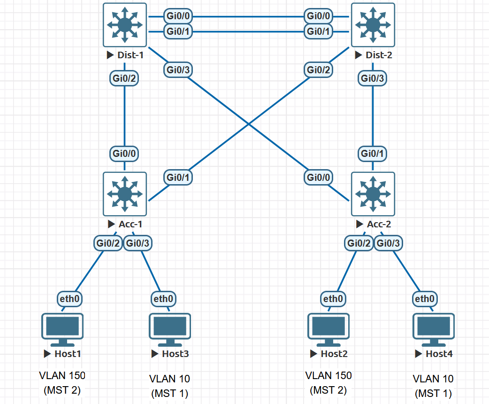
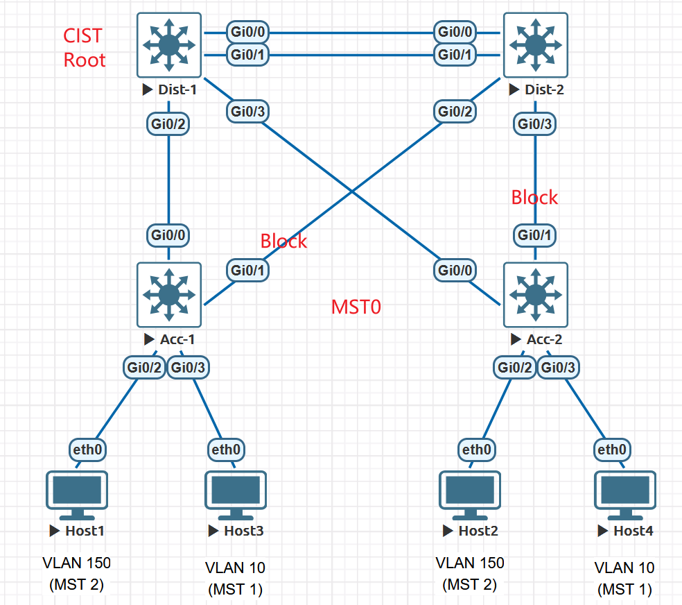
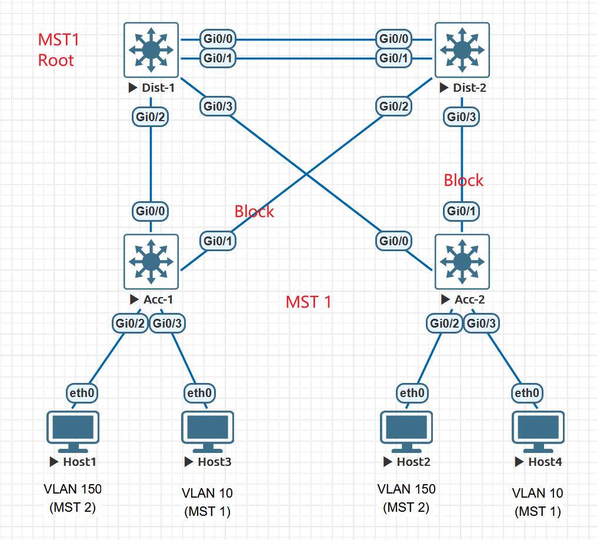
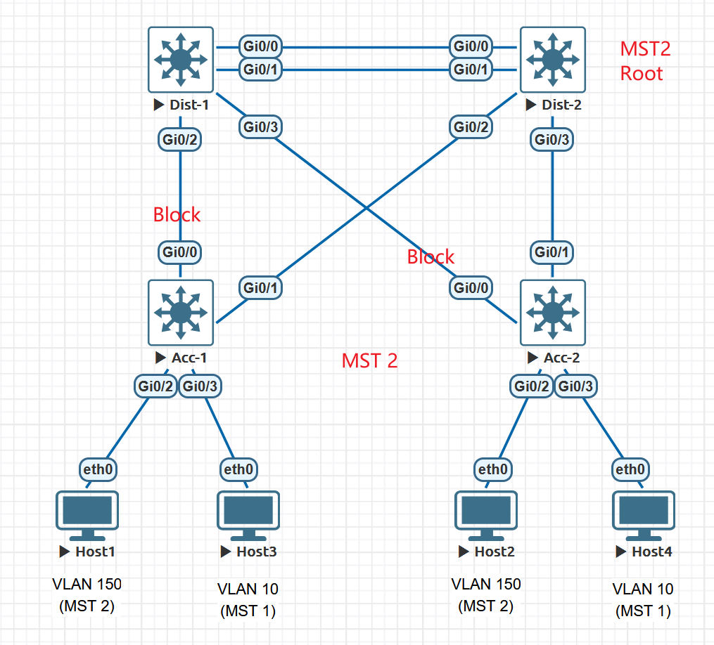

# MSTP Region Changes and Traffic Impact

This EVE-NG lab shows why a small MSTP change can interrupt traffic. In the change, one new VLAN is mapped to an existing instance, one switch at a time. While the switches still disagree on the VLAN-to-instance mapping, the single MST region temporarily splits into several regions. Ports become region boundaries. On a boundary port, every MST instance inherits the port role of the Common and Internal Spanning Tree (CIST). As a result, an instance whose root differs from the CIST root is pulled onto different uplinks at several points during the change.

The scenario is adapted from [CostiSer's Quiz #19](https://costiser.ro/2013/10/04/quiz-19/) and the published explanation, [How Can MSTP Configuration Changes Impact Your Network](https://costiser.ro/2014/02/13/how-can-mstp-configuration-changes-impact-your-network/). The interface numbering below follows this EVE-NG lab, not the original article. A mapping table is provided.

## Objectives

- Build a four-switch MSTP region with two distribution switches and two dual-homed access switches.
- Make Dist-1 the root for MST0 (the CIST) and MST1, and make Dist-2 the root for MST2.
- Map a new VLAN to MST2 one switch at a time, in the order used by the original quiz.
- Show that a mismatched configuration digest splits the network into temporary regions.
- Verify that region boundary ports carry the CIST role for every MSTI.
- Measure the traffic loss for a VLAN in MST2, where the instance root differs from the CIST root.
- Compare it with a VLAN in MST1, where the instance root matches the CIST root.
- Identify what triggers the outage when the forwarding path does not change.

## Environment and Scope

| Item | Value |
| --- | --- |
| Platform | EVE-NG |
| Switches | Four Cisco IOSvL2 nodes: Dist-1, Dist-2, Acc-1, Acc-2 |
| Hosts | Four VPCS nodes |
| STP mode | MSTP (`spanning-tree mode mst`) |
| MST region | name `abc`, revision `3` |
| Original mapping | MST1: VLAN 1-99. MST2: VLAN 100-199. MST0: everything else |
| Change under test | Add VLAN 200 to MST2 |

Timers stay at their defaults: hello 2 s, forward delay 15 s, max age 20 s. The roughly 30-second outage described in the original article equals two forward-delay intervals. Changing any timer would change the result.

## Control-Plane Model

### What defines an MST region

Two adjacent switches belong to the same MST region only when all three values match:

```text
Region name           abc
Revision number       3
VLAN-to-instance map  carried as a 16-byte MD5 digest in the MST BPDU
```

Switches compare the digest, not the mapping itself. A single extra VLAN in one instance changes the digest, so the neighbour treats the switch as a member of another region. Creating a VLAN does not change the digest. Only the mapping does.

A region must also be contiguous. Two switches with identical MST configurations stay in separate regions if switches from another region sit between them.

### What crosses a region boundary

```text
               Region X                     Region Y
         +-------------------+         +-------------------+
         | IST + MST1 + MST2 |         | IST + MST1 + MST2 |
         |   (internal)      |         |   (internal)      |
         +---------+---------+         +---------+---------+
                   |      boundary port          |
                   +-----------------------------+
                      only the CIST is computed
                      across this link
```

- Inside a region, every MSTI (MST1, MST2) has its own root and its own port roles.
- Between regions, only the CIST runs. Each region behaves like one large virtual bridge.
- On a boundary port, every MSTI uses the CIST role and state of that port. The CIST root port of a region's boundary switch appears as `Mstr` (master) in the MSTI output.
- The switch with the lowest bridge ID for MST0 becomes the CIST root. Each region chooses one CIST regional root: the boundary switch with the lowest external cost to the CIST root.

The quiz depends on one consequence of this design. MST2 is tuned to use Dist-2 as its root, but that tuning only applies inside the region that contains Dist-2. Any switch that ends up in another region forwards MST2 traffic along the CIST, which is rooted at Dist-1.

## Topology



### Cabling

| Link | Endpoint A | Endpoint B | Original article |
| --- | --- | --- | --- |
| Po1 member 1 | Dist-1 `Gi0/0` | Dist-2 `Gi0/0` | Po1 |
| Po1 member 2 | Dist-1 `Gi0/1` | Dist-2 `Gi0/1` | Po1 |
| Uplink | Dist-1 `Gi0/2` | Acc-1 `Gi0/0` | Dist-1 Gi0/13 - Acc-1 Gi0/16 |
| Uplink | Dist-1 `Gi0/3` | Acc-2 `Gi0/0` | Dist-1 Gi0/16 - Acc-2 Gi0/16 |
| Uplink | Dist-2 `Gi0/2` | Acc-1 `Gi0/1` | Dist-2 Gi0/13 - Acc-1 Gi0/19 |
| Uplink | Dist-2 `Gi0/3` | Acc-2 `Gi0/1` | Dist-2 Gi0/16 - Acc-2 Gi0/19 |
| Access | Acc-1 `Gi0/2` | Host-1 `eth0` | Hosts in VLAN 150 |
| Access | Acc-2 `Gi0/2` | Host-2 `eth0` | Hosts in VLAN 150 |
| Access | Acc-1 `Gi0/3` | Host-3 `eth0` | Added control group |
| Access | Acc-2 `Gi0/3` | Host-4 `eth0` | Added control group |

In every access switch, `Gi0/0` points to Dist-1 and `Gi0/1` points to Dist-2.

### Addressing and VLANs

| Host | Switch port | VLAN | MST instance | Address |
| --- | --- | --- | --- | --- |
| Host-1 | Acc-1 `Gi0/2` | 150 | MST2 | `10.150.0.11/24` |
| Host-2 | Acc-2 `Gi0/2` | 150 | MST2 | `10.150.0.12/24` |
| Host-3 | Acc-1 `Gi0/3` | 10 | MST1 | `10.10.0.13/24` |
| Host-4 | Acc-2 `Gi0/3` | 10 | MST1 | `10.10.0.14/24` |

The switches act only at Layer 2 and need no SVIs. VLAN 150 is the traffic under test, as in the article. VLAN 10 is a control group that this lab adds. Its instance root (Dist-1) matches the CIST root, so its forwarding path should not move.

### Bridge priorities

| Switch | MST0 / MST1 | MST2 | Role |
| --- | --- | --- | --- |
| Dist-1 | 4096 | 8192 | CIST root, MST1 root, MST2 secondary |
| Dist-2 | 8192 | 4096 | MST2 root, CIST and MST1 secondary |
| Acc-1 | 32768 (default) | 32768 (default) | Access |
| Acc-2 | 32768 (default) | 32768 (default) | Access |

## Initial Configuration

`vtp mode transparent` keeps every VLAN local to each switch, so that VTP cannot create VLANs on its own during the test. Host ports are deliberately **not** edge ports in this lab.

### Dist-1

```cisco
hostname Dist-1
!
service timestamps debug datetime msec
service timestamps log datetime msec
no ip domain lookup
logging buffered 64000 debugging
!
vtp mode transparent
!
vlan 10
 name MST1-CONTROL
vlan 150
 name MST2-TEST
!
spanning-tree mode mst
spanning-tree mst configuration
 name abc
 revision 3
 instance 1 vlan 1-99
 instance 2 vlan 100-199
!
spanning-tree mst 0-1 priority 4096
spanning-tree mst 2 priority 8192
!
interface range GigabitEthernet0/0 - 1
 description TO-Dist-2-Po1-MEMBER
 switchport trunk encapsulation dot1q
 switchport mode trunk
 channel-group 1 mode active
 no shutdown
!
interface Port-channel1
 description TO-Dist-2
 switchport trunk encapsulation dot1q
 switchport mode trunk
!
interface GigabitEthernet0/2
 description TO-Acc-1-Gi0/0
 switchport trunk encapsulation dot1q
 switchport mode trunk
 no shutdown
!
interface GigabitEthernet0/3
 description TO-Acc-2-Gi0/0
 switchport trunk encapsulation dot1q
 switchport mode trunk
 no shutdown
```

### Dist-2

```cisco
hostname Dist-2
!
service timestamps debug datetime msec
service timestamps log datetime msec
no ip domain lookup
logging buffered 64000 debugging
!
vtp mode transparent
!
vlan 10
 name MST1-CONTROL
vlan 150
 name MST2-TEST
!
spanning-tree mode mst
spanning-tree mst configuration
 name abc
 revision 3
 instance 1 vlan 1-99
 instance 2 vlan 100-199
!
spanning-tree mst 0-1 priority 8192
spanning-tree mst 2 priority 4096
!
interface range GigabitEthernet0/0 - 1
 description TO-Dist-1-Po1-MEMBER
 switchport trunk encapsulation dot1q
 switchport mode trunk
 channel-group 1 mode active
 no shutdown
!
interface Port-channel1
 description TO-Dist-1
 switchport trunk encapsulation dot1q
 switchport mode trunk
!
interface GigabitEthernet0/2
 description TO-Acc-1-Gi0/1
 switchport trunk encapsulation dot1q
 switchport mode trunk
 no shutdown
!
interface GigabitEthernet0/3
 description TO-Acc-2-Gi0/1
 switchport trunk encapsulation dot1q
 switchport mode trunk
 no shutdown
```

### Acc-1

```cisco
hostname Acc-1
!
service timestamps debug datetime msec
service timestamps log datetime msec
no ip domain lookup
logging buffered 64000 debugging
!
vtp mode transparent
!
vlan 10
 name MST1-CONTROL
vlan 150
 name MST2-TEST
!
spanning-tree mode mst
spanning-tree mst configuration
 name abc
 revision 3
 instance 1 vlan 1-99
 instance 2 vlan 100-199
!
interface GigabitEthernet0/0
 description TO-Dist-1-Gi0/2
 switchport trunk encapsulation dot1q
 switchport mode trunk
 no shutdown
!
interface GigabitEthernet0/1
 description TO-Dist-2-Gi0/2
 switchport trunk encapsulation dot1q
 switchport mode trunk
 no shutdown
!
interface GigabitEthernet0/2
 description Host-1-VLAN150
 switchport mode access
 switchport access vlan 150
 no shutdown
!
interface GigabitEthernet0/3
 description Host-3-VLAN10
 switchport mode access
 switchport access vlan 10
 no shutdown
```

### Acc-2

```cisco
hostname Acc-2
!
service timestamps debug datetime msec
service timestamps log datetime msec
no ip domain lookup
logging buffered 64000 debugging
!
vtp mode transparent
!
vlan 10
 name MST1-CONTROL
vlan 150
 name MST2-TEST
!
spanning-tree mode mst
spanning-tree mst configuration
 name abc
 revision 3
 instance 1 vlan 1-99
 instance 2 vlan 100-199
!
interface GigabitEthernet0/0
 description TO-Dist-1-Gi0/3
 switchport trunk encapsulation dot1q
 switchport mode trunk
 no shutdown
!
interface GigabitEthernet0/1
 description TO-Dist-2-Gi0/3
 switchport trunk encapsulation dot1q
 switchport mode trunk
 no shutdown
!
interface GigabitEthernet0/2
 description Host-2-VLAN150
 switchport mode access
 switchport access vlan 150
 no shutdown
!
interface GigabitEthernet0/3
 description Host-4-VLAN10
 switchport mode access
 switchport access vlan 10
 no shutdown
```

### VPCS hosts

```text
Host-1> ip 10.150.0.11/24
Host-1> save

Host-2> ip 10.150.0.12/24
Host-2> save

Host-3> ip 10.10.0.13/24
Host-3> save

Host-4> ip 10.10.0.14/24
Host-4> save
```

No gateway is needed because each test pair shares a VLAN.

## Baseline Verification

Complete this section before you change anything.

### Region consistency

All four switches must report the same name, revision, mapping, and digest:

```cisco
show spanning-tree mst configuration
show spanning-tree mst configuration digest
```

```text
Dist-1#sh spanning-tree mst configuration
Name      [abc]
Revision  3     Instances configured 3

Instance  Vlans mapped
--------  ---------------------------------------------------------------------
0         200-4094
1         1-99
2         100-199
-------------------------------------------------------------------------------

```

```text
Dist-1#show spanning-tree mst configuration digest
Name      [abc]
Revision  3     Instances configured 3
Digest          0xE5DF604EE14B7DA5A17937F64792AE28
Pre-std Digest  0x942FA99583DC9396D644BBFDCFF0DDA4

Dist-2#show spanning-tree mst configuration digest
Name      [abc]
Revision  3     Instances configured 3
Digest          0xE5DF604EE14B7DA5A17937F64792AE28
Pre-std Digest  0x942FA99583DC9396D644BBFDCFF0DDA4

Acc-1#show spanning-tree mst configuration digest
Name      [abc]
Revision  3     Instances configured 3
Digest          0xE5DF604EE14B7DA5A17937F64792AE28
Pre-std Digest  0x942FA99583DC9396D644BBFDCFF0DDA4

Acc-2#show spanning-tree mst configuration digest
Name      [abc]
Revision  3     Instances configured 3
Digest          0xE5DF604EE14B7DA5A17937F64792AE28
Pre-std Digest  0x942FA99583DC9396D644BBFDCFF0DDA4
```

### Underlay

```cisco
show etherchannel summary
show interfaces trunk
```

```text
Dist-1#sh etherchannel summary
Flags:  D - down        P - bundled in port-channel
        I - stand-alone s - suspended
        H - Hot-standby (LACP only)
        R - Layer3      S - Layer2
        U - in use      N - not in use, no aggregation
        f - failed to allocate aggregator

        M - not in use, minimum links not met
        m - not in use, port not aggregated due to minimum links not met
        u - unsuitable for bundling
        w - waiting to be aggregated
        d - default port

        A - formed by Auto LAG


Number of channel-groups in use: 1
Number of aggregators:           1

Group  Port-channel  Protocol    Ports
------+-------------+-----------+-----------------------------------------------
1      Po1(SU)         LACP      Gi0/0(P)    Gi0/1(P)

Acc-1#show interface trunk

Port        Mode             Encapsulation  Status        Native vlan
Gi0/0       on               802.1q         trunking      1
Gi0/1       on               802.1q         trunking      1

Port        Vlans allowed on trunk
Gi0/0       1-4094
Gi0/1       1-4094

Port        Vlans allowed and active in management domain
Gi0/0       1,10,150
Gi0/1       1,10,150

Port        Vlans in spanning tree forwarding state and not pruned
Gi0/0       1,10
Gi0/1       150
```

### Baseline spanning-tree roles

Expected baseline state:

| Instance | Root | Acc-1 `Gi0/0` (to Dist-1) | Acc-1 `Gi0/1` (to Dist-2) | Acc-2 `Gi0/0` (to Dist-1) | Acc-2 `Gi0/1` (to Dist-2) |
| --- | --- | --- | --- | --- | --- |
| MST0 / MST1 | Dist-1 | Root FWD | Altn BLK | Root FWD | Altn BLK |
| MST2 | Dist-2 | Altn BLK | Root FWD | Altn BLK | Root FWD |







### Baseline forwarding path

Record each host's MAC address, then check which uplink Acc-1 uses to reach the remote host:

```text
Host-2> show ip
Host-4> show ip
```

```cisco
Acc-1# show mac address-table address <Host-2-MAC>
Acc-1# show mac address-table address <Host-4-MAC>
```

Expected: Acc-1 learns Host-2 (VLAN 150) on `Gi0/1` toward Dist-2, and Host-4 (VLAN 10) on `Gi0/0` toward Dist-1.

```text
Host2> show ip
IP/MASK     : 10.150.0.12/24
MAC         : 00:50:79:66:68:07

Host4> show ip
IP/MASK     : 10.10.0.14/24
MAC         : 00:50:79:66:68:08

Acc-1# show mac address-table address 00:50:79:66:68:07
          Mac Address Table
-------------------------------------------
Vlan    Mac Address       Type        Ports
----    -----------       --------    -----
 150    0050.7966.6807    DYNAMIC     Gi0/1
 
Acc-1# show mac address-table address 00:50:79:66:68:08
          Mac Address Table
-------------------------------------------
Vlan    Mac Address       Type        Ports
----    -----------       --------    -----
  10    0050.7966.6808    DYNAMIC     Gi0/0
```

## Test Procedure

### Measuring the outage

Before each stage, start a continuous ping in **both** VLANs:

```text
Host-1> ping 10.150.0.12 -t
Host-3> ping 10.10.0.14 -t
```

Wait for a few successful replies, apply the change, then wait until replies have been stable for at least 60 seconds. Stop with `Ctrl+C` and count the `timeout` lines.

A VPCS timeout line does **not** represent one second. VPCS waits up to 1000 ms for a reply, then waits its 1000 ms send interval before the next probe, so each timeout covers about 2 seconds. A successful probe covers about 1 second.

If you want finer resolution, replace the VPCS hosts with Linux nodes and use `ping -D -O -i 0.2`.

### Optional debugging

Turn on these debugs on Acc-1 and Dist-1 before each change, then read `show logging` after convergence. The available keywords vary by image, so check them with `?`.

```cisco
debug spanning-tree mstp region
debug spanning-tree mstp boundary
debug spanning-tree mstp roles
debug spanning-tree mstp sync
```

Remember to `undebug all` after the lab.

### Applying the change on IOS

The MST configuration submode does not apply changes line by line. Edits take effect together when you leave the submode. Use `show pending` to review them first:

```cisco
Acc-1(config)# vlan 200
Acc-1(config-vlan)# name NEW-VLAN
Acc-1(config-vlan)# exit
Acc-1(config)# spanning-tree mst configuration
Acc-1(config-mst)# instance 2 vlan 200
Acc-1(config-mst)# show pending
Acc-1(config-mst)# exit
```

Creating VLAN 200 does not change the digest. Exiting the MST submode does.

## Test: Map VLAN 200 to MST2

Follow the original quiz order: **Acc-1 → Acc-2 → Dist-1 → Dist-2**. To keep the measurements separate, create VLAN 200 on all four switches first and confirm that the digest has not changed. Then apply only the MST mapping change at each stage.

At every stage, capture:

```cisco
show spanning-tree mst configuration digest
show spanning-tree mst 0
show spanning-tree mst 2
show spanning-tree mst interface <uplink>
show spanning-tree vlan 200
```

`show spanning-tree mst interface` reports `Boundary` as `internal` on links inside a region, and the `Type` column marks boundary ports as `Bound(RSTP)`. In this lab, only the receiving end of a boundary link showed the marker. See [Boundary detection is one-sided](#boundary-detection-is-one-sided).

### Expected region and root state

| Stage | Changed so far | Regions | CIST root | CIST regional roots | MST2 root in each region |
| --- | --- | --- | --- | --- | --- |
| 0 | None | {Dist-1, Dist-2, Acc-1, Acc-2} | Dist-1 | Dist-1 | Dist-2 |
| 1 | Acc-1 | Old {Dist-1, Dist-2, Acc-2}, New {Acc-1} | Dist-1 | Dist-1, Acc-1 | Dist-2, Acc-1 |
| 2 | Acc-1, Acc-2 | Old {Dist-1, Dist-2}, New {Acc-1}, New {Acc-2} | Dist-1 | Dist-1, Acc-1, Acc-2 | Dist-2, Acc-1, Acc-2 |
| 3 | Acc-1, Acc-2, Dist-1 | New {Dist-1, Acc-1, Acc-2}, Old {Dist-2} | Dist-1 | Dist-1, Dist-2 | Dist-1, Dist-2 |
| 4 | All | New {Dist-1, Dist-2, Acc-1, Acc-2} | Dist-1 | Dist-1 | Dist-2 |

At Stage 2, Acc-1 and Acc-2 have identical configurations but are still separate regions. They have no direct link, and the switches between them still use the old digest.

### Expected MST2 (VLAN 150) state

| Stage | Acc-1 `Gi0/0` | Acc-1 `Gi0/1` | Acc-2 `Gi0/0` | Acc-2 `Gi0/1` | VLAN 150 path | Path changed? |
| --- | --- | --- | --- | --- | --- | --- |
| 0 | Altn BLK | Root FWD | Altn BLK | Root FWD | Acc-1 → Dist-2 → Acc-2 | n/a |
| 1 | Mstr FWD | Altn BLK | Altn BLK | Root FWD | Acc-1 → Dist-1 → Po1 → Dist-2 → Acc-2 | Yes, on Acc-1 |
| 2 | Mstr FWD | Altn BLK | Mstr FWD | Altn BLK | Acc-1 → Dist-1 → Acc-2 | Yes, on Acc-2 |
| 3 | Root FWD | Desg FWD\* | Root FWD | Desg FWD\* | Acc-1 → Dist-1 → Acc-2 | No |
| 4 | Altn BLK | Root FWD | Altn BLK | Root FWD | Acc-1 → Dist-2 → Acc-2 | Yes, on both |

\* At Stage 3, Dist-2 is the only switch left in the old region. Its external root path cost goes through Po1, while the access switches share a region with the CIST root and advertise an external cost of 0. The access-switch ports therefore win the designated role, and Dist-2 `Gi0/2` and `Gi0/3` become `Altn BLK`. The link still does not forward.

### Expected MST1 (VLAN 10) state

MST1 is rooted at Dist-1, the same switch as the CIST. In every stage, both access switches should keep `Gi0/0` forwarding toward Dist-1 and `Gi0/1` not forwarding. At Stages 1 and 2, the forwarding uplink of a split-off access switch should appear as `Mstr` instead of `Root`. The VLAN 10 path should remain Acc-1 → Dist-1 → Acc-2 throughout.

**Hypothesis to test:** VLAN 10 sees no loss, or much less loss than VLAN 150. Region transitions can still cause topology-change MAC flushing, so measure this rather than assume it. The measurements showed loss at Stages 1 to 3 and none at Stage 4. See [Results](#results).

### Stage 1: Acc-1

```cisco
Acc-1(config)# spanning-tree mst configuration
Acc-1(config-mst)# instance 2 vlan 200
Acc-1(config-mst)# exit
```

```text
Acc-1#show spanning-tree mst configuration digest
Name      [abc]
Revision  3     Instances configured 3
Digest          0x9759A813234774061B78C0844C246640
Pre-std Digest  0x1B8DC618214DED39A71E82DB2857690E
```

```text
Acc-1#show spanning-tree mst 0

##### MST0    vlans mapped:   201-4094
Bridge        address 5000.0003.0000  priority      32768 (32768 sysid 0)
Root          address 5000.0001.0000  priority      4096  (4096 sysid 0)
              port    Gi0/0           path cost     20000    
Regional Root this switch
Operational   hello time 2 , forward delay 15, max age 20, txholdcount 6 
Configured    hello time 2 , forward delay 15, max age 20, max hops    20

Interface        Role Sts Cost      Prio.Nbr Type
---------------- ---- --- --------- -------- --------------------------------
Gi0/0            Root FWD 20000     128.1    P2p Bound(RSTP) 
Gi0/1            Altn BLK 20000     128.2    P2p Bound(RSTP) 
Gi0/2            Desg FWD 20000     128.3    P2p 
Gi0/3            Desg FWD 20000     128.4    P2p 
Gi1/0            Desg FWD 20000     128.5    P2p 
Gi1/1            Desg FWD 20000     128.6    P2p 
Gi1/2            Desg FWD 20000     128.7    P2p 
Gi1/3            Desg FWD 20000     128.8    P2p
```

```text
Acc-1#show spanning-tree mst 2

##### MST2    vlans mapped:   100-200
Bridge        address 5000.0003.0000  priority      32770 (32768 sysid 2)
Root          this switch for MST2

Interface        Role Sts Cost      Prio.Nbr Type
---------------- ---- --- --------- -------- --------------------------------
Gi0/0            Mstr FWD 20000     128.1    P2p Bound(RSTP) 
Gi0/1            Altn BLK 20000     128.2    P2p Bound(RSTP) 
Gi0/2            Desg FWD 20000     128.3    P2p
```

```text
Dist-1#show spanning-tree mst interface Gi0/2

GigabitEthernet0/2 of MST0 is designated forwarding 
Portfast : no             (default)        port guard : none        (default)
Link type: point-to-point (auto)           bpdu filter: disable     (default)
Boundary : internal                        bpdu guard : disable     (default)
PVST Sim : enable         (default)       
Bpdus sent 1008, received 34

Instance Role Sts Cost      Prio.Nbr Vlans mapped
-------- ---- --- --------- -------- -------------------------------
0        Desg FWD 20000     128.3    200-4094
1        Desg FWD 20000     128.3    1-99
2        Desg FWD 20000     128.3    100-199
```

```text
Host1:
84 bytes from 10.150.0.12 icmp_seq=284 ttl=64 time=3.340 ms
84 bytes from 10.150.0.12 icmp_seq=285 ttl=64 time=4.359 ms
84 bytes from 10.150.0.12 icmp_seq=286 ttl=64 time=3.321 ms
84 bytes from 10.150.0.12 icmp_seq=287 ttl=64 time=3.109 ms
10.150.0.12 icmp_seq=288 timeout
10.150.0.12 icmp_seq=289 timeout
10.150.0.12 icmp_seq=290 timeout
10.150.0.12 icmp_seq=291 timeout
10.150.0.12 icmp_seq=292 timeout
10.150.0.12 icmp_seq=293 timeout
10.150.0.12 icmp_seq=294 timeout
10.150.0.12 icmp_seq=295 timeout
10.150.0.12 icmp_seq=296 timeout
10.150.0.12 icmp_seq=297 timeout
10.150.0.12 icmp_seq=298 timeout
10.150.0.12 icmp_seq=299 timeout
10.150.0.12 icmp_seq=300 timeout
10.150.0.12 icmp_seq=301 timeout
10.150.0.12 icmp_seq=302 timeout
84 bytes from 10.150.0.12 icmp_seq=303 ttl=64 time=5.346 ms
84 bytes from 10.150.0.12 icmp_seq=304 ttl=64 time=4.848 ms
84 bytes from 10.150.0.12 icmp_seq=305 ttl=64 time=4.631 ms
84 bytes from 10.150.0.12 icmp_seq=306 ttl=64 time=4.720 ms

Host3:
84 bytes from 10.10.0.14 icmp_seq=279 ttl=64 time=3.867 ms
84 bytes from 10.10.0.14 icmp_seq=280 ttl=64 time=4.230 ms
84 bytes from 10.10.0.14 icmp_seq=281 ttl=64 time=3.944 ms
84 bytes from 10.10.0.14 icmp_seq=282 ttl=64 time=3.491 ms
10.10.0.14 icmp_seq=283 timeout
10.10.0.14 icmp_seq=284 timeout
10.10.0.14 icmp_seq=285 timeout
10.10.0.14 icmp_seq=286 timeout
10.10.0.14 icmp_seq=287 timeout
10.10.0.14 icmp_seq=288 timeout
10.10.0.14 icmp_seq=289 timeout
10.10.0.14 icmp_seq=290 timeout
10.10.0.14 icmp_seq=291 timeout
10.10.0.14 icmp_seq=292 timeout
10.10.0.14 icmp_seq=293 timeout
10.10.0.14 icmp_seq=294 timeout
10.10.0.14 icmp_seq=295 timeout
10.10.0.14 icmp_seq=296 timeout
10.10.0.14 icmp_seq=297 timeout
84 bytes from 10.10.0.14 icmp_seq=298 ttl=64 time=4.277 ms
84 bytes from 10.10.0.14 icmp_seq=299 ttl=64 time=3.053 ms
84 bytes from 10.10.0.14 icmp_seq=300 ttl=64 time=3.762 ms
84 bytes from 10.10.0.14 icmp_seq=301 ttl=64 time=3.788 ms
84 bytes from 10.10.0.14 icmp_seq=302 ttl=64 time=3.829 ms
```

### Stage 2: Acc-2

```cisco
Acc-2(config)# spanning-tree mst configuration
Acc-2(config-mst)# instance 2 vlan 200
Acc-2(config-mst)# exit
```

```text
Acc-2#show spanning-tree mst 2

##### MST2    vlans mapped:   100-200
Bridge        address 5000.0004.0000  priority      32770 (32768 sysid 2)
Root          this switch for MST2

Interface        Role Sts Cost      Prio.Nbr Type
---------------- ---- --- --------- -------- --------------------------------
Gi0/0            Mstr FWD 20000     128.1    P2p Bound(RSTP) 
Gi0/1            Altn BLK 20000     128.2    P2p Bound(RSTP) 
Gi0/2            Desg FWD 20000     128.3    P2p
```

```text
Dist-1#show spanning-tree mst 2

##### MST2    vlans mapped:   100-199
Bridge        address 5000.0001.0000  priority      8194  (8192 sysid 2)
Root          address 5000.0002.0000  priority      4098  (4096 sysid 2)
              port    Po1             cost          10000     rem hops 19

Interface        Role Sts Cost      Prio.Nbr Type
---------------- ---- --- --------- -------- --------------------------------
Gi0/2            Desg FWD 20000     128.3    P2p 
Gi0/3            Desg FWD 20000     128.4    P2p 
Po1              Root FWD 10000     128.65   P2p
```

```text
Host 1 :
84 bytes from 10.150.0.12 icmp_seq=196 ttl=64 time=5.360 ms
84 bytes from 10.150.0.12 icmp_seq=197 ttl=64 time=4.874 ms
84 bytes from 10.150.0.12 icmp_seq=198 ttl=64 time=4.407 ms
84 bytes from 10.150.0.12 icmp_seq=199 ttl=64 time=5.093 ms
10.150.0.12 icmp_seq=200 timeout
10.150.0.12 icmp_seq=201 timeout
10.150.0.12 icmp_seq=202 timeout
10.150.0.12 icmp_seq=203 timeout
10.150.0.12 icmp_seq=204 timeout
10.150.0.12 icmp_seq=205 timeout
10.150.0.12 icmp_seq=206 timeout
10.150.0.12 icmp_seq=207 timeout
10.150.0.12 icmp_seq=208 timeout
10.150.0.12 icmp_seq=209 timeout
10.150.0.12 icmp_seq=210 timeout
10.150.0.12 icmp_seq=211 timeout
10.150.0.12 icmp_seq=212 timeout
10.150.0.12 icmp_seq=213 timeout
10.150.0.12 icmp_seq=214 timeout
84 bytes from 10.150.0.12 icmp_seq=215 ttl=64 time=3.541 ms
84 bytes from 10.150.0.12 icmp_seq=216 ttl=64 time=2.994 ms
84 bytes from 10.150.0.12 icmp_seq=217 ttl=64 time=4.046 ms
84 bytes from 10.150.0.12 icmp_seq=218 ttl=64 time=2.796 ms

Host 3:
84 bytes from 10.10.0.14 icmp_seq=157 ttl=64 time=3.986 ms
84 bytes from 10.10.0.14 icmp_seq=158 ttl=64 time=2.718 ms
84 bytes from 10.10.0.14 icmp_seq=159 ttl=64 time=3.106 ms
84 bytes from 10.10.0.14 icmp_seq=160 ttl=64 time=3.981 ms
10.10.0.14 icmp_seq=161 timeout
10.10.0.14 icmp_seq=162 timeout
10.10.0.14 icmp_seq=163 timeout
10.10.0.14 icmp_seq=164 timeout
10.10.0.14 icmp_seq=165 timeout
10.10.0.14 icmp_seq=166 timeout
10.10.0.14 icmp_seq=167 timeout
10.10.0.14 icmp_seq=168 timeout
10.10.0.14 icmp_seq=169 timeout
10.10.0.14 icmp_seq=170 timeout
10.10.0.14 icmp_seq=171 timeout
10.10.0.14 icmp_seq=172 timeout
10.10.0.14 icmp_seq=173 timeout
10.10.0.14 icmp_seq=174 timeout
10.10.0.14 icmp_seq=175 timeout
84 bytes from 10.10.0.14 icmp_seq=176 ttl=64 time=3.333 ms
84 bytes from 10.10.0.14 icmp_seq=177 ttl=64 time=2.872 ms
84 bytes from 10.10.0.14 icmp_seq=178 ttl=64 time=4.034 ms
84 bytes from 10.10.0.14 icmp_seq=179 ttl=64 time=3.906 ms
84 bytes from 10.10.0.14 icmp_seq=180 ttl=64 time=4.487 ms
```

### Stage 3: Dist-1

```cisco
Dist-1(config)# spanning-tree mst configuration
Dist-1(config-mst)# instance 2 vlan 200
Dist-1(config-mst)# exit
```

```text
Dist-1#show spanning-tree mst 2

##### MST2    vlans mapped:   100-200
Bridge        address 5000.0001.0000  priority      8194  (8192 sysid 2)
Root          this switch for MST2

Interface        Role Sts Cost      Prio.Nbr Type
---------------- ---- --- --------- -------- --------------------------------
Gi0/2            Desg FWD 20000     128.3    P2p 
Gi0/3            Desg FWD 20000     128.4    P2p 
Po1              Desg FWD 10000     128.65   P2p
```

```text
Dist-2#show spanning-tree mst 0

##### MST0    vlans mapped:   200-4094
Bridge        address 5000.0002.0000  priority      8192  (8192 sysid 0)
Root          address 5000.0001.0000  priority      4096  (4096 sysid 0)
              port    Po1             path cost     10000    
Regional Root this switch
Operational   hello time 2 , forward delay 15, max age 20, txholdcount 6 
Configured    hello time 2 , forward delay 15, max age 20, max hops    20

Interface        Role Sts Cost      Prio.Nbr Type
---------------- ---- --- --------- -------- --------------------------------
Gi0/2            Altn BLK 20000     128.3    P2p Bound(RSTP) 
Gi0/3            Altn BLK 20000     128.4    P2p Bound(RSTP) 
Gi1/0            Desg FWD 20000     128.5    P2p 
Gi1/1            Desg FWD 20000     128.6    P2p 
Gi1/2            Desg FWD 20000     128.7    P2p 
Gi1/3            Desg FWD 20000     128.8    P2p 
Po1              Root FWD 10000     128.65   P2p Bound(RSTP)
```

```text
Acc-1#show spanning-tree mst 2

##### MST2    vlans mapped:   100-200
Bridge        address 5000.0003.0000  priority      32770 (32768 sysid 2)
Root          address 5000.0001.0000  priority      8194  (8192 sysid 2)
              port    Gi0/0           cost          20000     rem hops 19

Interface        Role Sts Cost      Prio.Nbr Type
---------------- ---- --- --------- -------- --------------------------------
Gi0/0            Root FWD 20000     128.1    P2p 
Gi0/1            Desg FWD 20000     128.2    P2p 
Gi0/2            Desg FWD 20000     128.3    P2p
```

```text
Host 1:
84 bytes from 10.150.0.12 icmp_seq=16 ttl=64 time=4.008 ms
84 bytes from 10.150.0.12 icmp_seq=17 ttl=64 time=3.746 ms
84 bytes from 10.150.0.12 icmp_seq=18 ttl=64 time=3.463 ms
84 bytes from 10.150.0.12 icmp_seq=19 ttl=64 time=3.456 ms
10.150.0.12 icmp_seq=20 timeout
10.150.0.12 icmp_seq=21 timeout
10.150.0.12 icmp_seq=22 timeout
10.150.0.12 icmp_seq=23 timeout
10.150.0.12 icmp_seq=24 timeout
10.150.0.12 icmp_seq=25 timeout
10.150.0.12 icmp_seq=26 timeout
10.150.0.12 icmp_seq=27 timeout
10.150.0.12 icmp_seq=28 timeout
10.150.0.12 icmp_seq=29 timeout
10.150.0.12 icmp_seq=30 timeout
10.150.0.12 icmp_seq=31 timeout
10.150.0.12 icmp_seq=32 timeout
10.150.0.12 icmp_seq=33 timeout
10.150.0.12 icmp_seq=34 timeout
84 bytes from 10.150.0.12 icmp_seq=35 ttl=64 time=3.751 ms
84 bytes from 10.150.0.12 icmp_seq=36 ttl=64 time=4.517 ms
84 bytes from 10.150.0.12 icmp_seq=37 ttl=64 time=3.514 ms
84 bytes from 10.150.0.12 icmp_seq=38 ttl=64 time=3.513 ms

Host 3:
84 bytes from 10.10.0.14 icmp_seq=18 ttl=64 time=4.334 ms
84 bytes from 10.10.0.14 icmp_seq=19 ttl=64 time=3.870 ms
84 bytes from 10.10.0.14 icmp_seq=20 ttl=64 time=2.457 ms
10.10.0.14 icmp_seq=21 timeout
10.10.0.14 icmp_seq=22 timeout
10.10.0.14 icmp_seq=23 timeout
10.10.0.14 icmp_seq=24 timeout
10.10.0.14 icmp_seq=25 timeout
10.10.0.14 icmp_seq=26 timeout
10.10.0.14 icmp_seq=27 timeout
10.10.0.14 icmp_seq=28 timeout
10.10.0.14 icmp_seq=29 timeout
10.10.0.14 icmp_seq=30 timeout
10.10.0.14 icmp_seq=31 timeout
10.10.0.14 icmp_seq=32 timeout
10.10.0.14 icmp_seq=33 timeout
10.10.0.14 icmp_seq=34 timeout
10.10.0.14 icmp_seq=35 timeout
84 bytes from 10.10.0.14 icmp_seq=36 ttl=64 time=4.294 ms
84 bytes from 10.10.0.14 icmp_seq=37 ttl=64 time=4.279 ms
84 bytes from 10.10.0.14 icmp_seq=38 ttl=64 time=4.375 ms
```

### Stage 4: Dist-2

```cisco
Dist-2(config)# spanning-tree mst configuration
Dist-2(config-mst)# instance 2 vlan 200
Dist-2(config-mst)# exit
```

```text
Dist-2#show spanning-tree mst configuration digest
Name      [abc]
Revision  3     Instances configured 3
Digest          0x9759A813234774061B78C0844C246640
Pre-std Digest  0x1B8DC618214DED39A71E82DB2857690E

Dist-1#show spanning-tree mst configuration digest
Name      [abc]
Revision  3     Instances configured 3
Digest          0x9759A813234774061B78C0844C246640
Pre-std Digest  0x1B8DC618214DED39A71E82DB2857690E

Acc-2#show spanning-tree mst configuration digest
Name      [abc]
Revision  3     Instances configured 3
Digest          0x9759A813234774061B78C0844C246640
Pre-std Digest  0x1B8DC618214DED39A71E82DB2857690E

Acc-1#show spanning-tree mst configuration digest
Name      [abc]
Revision  3     Instances configured 3
Digest          0x9759A813234774061B78C0844C246640
Pre-std Digest  0x1B8DC618214DED39A71E82DB2857690E
```

```text
Acc-1#show spanning-tree mst 2

##### MST2    vlans mapped:   100-200
Bridge        address 5000.0003.0000  priority      32770 (32768 sysid 2)
Root          address 5000.0002.0000  priority      4098  (4096 sysid 2)
              port    Gi0/1           cost          20000     rem hops 19

Interface        Role Sts Cost      Prio.Nbr Type
---------------- ---- --- --------- -------- --------------------------------
Gi0/0            Altn BLK 20000     128.1    P2p 
Gi0/1            Root FWD 20000     128.2    P2p 
Gi0/2            Desg FWD 20000     128.3    P2p

Acc-2#show spanning-tree mst 2

##### MST2    vlans mapped:   100-200
Bridge        address 5000.0004.0000  priority      32770 (32768 sysid 2)
Root          address 5000.0002.0000  priority      4098  (4096 sysid 2)
              port    Gi0/1           cost          20000     rem hops 19

Interface        Role Sts Cost      Prio.Nbr Type
---------------- ---- --- --------- -------- --------------------------------
Gi0/0            Altn BLK 20000     128.1    P2p 
Gi0/1            Root FWD 20000     128.2    P2p 
Gi0/2            Desg FWD 20000     128.3    P2p
```

```text
Acc-1#show spanning-tree vlan 200

MST2
  Spanning tree enabled protocol mstp
  Root ID    Priority    4098
             Address     5000.0002.0000
             Cost        20000
             Port        2 (GigabitEthernet0/1)
             Hello Time   2 sec  Max Age 20 sec  Forward Delay 15 sec

  Bridge ID  Priority    32770  (priority 32768 sys-id-ext 2)
             Address     5000.0003.0000
             Hello Time   2 sec  Max Age 20 sec  Forward Delay 15 sec

Interface           Role Sts Cost      Prio.Nbr Type
------------------- ---- --- --------- -------- --------------------------------
Gi0/0               Altn BLK 20000     128.1    P2p 
Gi0/1               Root FWD 20000     128.2    P2p
```

```text
Host 1:
84 bytes from 10.150.0.12 icmp_seq=17 ttl=64 time=3.513 ms
84 bytes from 10.150.0.12 icmp_seq=18 ttl=64 time=3.950 ms
84 bytes from 10.150.0.12 icmp_seq=19 ttl=64 time=3.346 ms
10.150.0.12 icmp_seq=20 timeout
10.150.0.12 icmp_seq=21 timeout
10.150.0.12 icmp_seq=22 timeout
10.150.0.12 icmp_seq=23 timeout
10.150.0.12 icmp_seq=24 timeout
10.150.0.12 icmp_seq=25 timeout
10.150.0.12 icmp_seq=26 timeout
10.150.0.12 icmp_seq=27 timeout
10.150.0.12 icmp_seq=28 timeout
10.150.0.12 icmp_seq=29 timeout
10.150.0.12 icmp_seq=30 timeout
10.150.0.12 icmp_seq=31 timeout
10.150.0.12 icmp_seq=32 timeout
10.150.0.12 icmp_seq=33 timeout
10.150.0.12 icmp_seq=34 timeout
84 bytes from 10.150.0.12 icmp_seq=35 ttl=64 time=5.078 ms
84 bytes from 10.150.0.12 icmp_seq=36 ttl=64 time=3.681 ms
84 bytes from 10.150.0.12 icmp_seq=37 ttl=64 time=2.995 ms

Host 3:
84 bytes from 10.10.0.14 icmp_seq=65 ttl=64 time=4.160 ms
84 bytes from 10.10.0.14 icmp_seq=66 ttl=64 time=3.504 ms
84 bytes from 10.10.0.14 icmp_seq=67 ttl=64 time=3.468 ms
84 bytes from 10.10.0.14 icmp_seq=68 ttl=64 time=3.289 ms
84 bytes from 10.10.0.14 icmp_seq=69 ttl=64 time=3.116 ms
84 bytes from 10.10.0.14 icmp_seq=70 ttl=64 time=3.645 ms
84 bytes from 10.10.0.14 icmp_seq=71 ttl=64 time=3.053 ms
84 bytes from 10.10.0.14 icmp_seq=72 ttl=64 time=4.484 ms
84 bytes from 10.10.0.14 icmp_seq=73 ttl=64 time=3.714 ms
84 bytes from 10.10.0.14 icmp_seq=74 ttl=64 time=3.119 ms
84 bytes from 10.10.0.14 icmp_seq=75 ttl=64 time=3.429 ms
84 bytes from 10.10.0.14 icmp_seq=76 ttl=64 time=4.468 ms
84 bytes from 10.10.0.14 icmp_seq=77 ttl=64 time=3.773 ms
84 bytes from 10.10.0.14 icmp_seq=78 ttl=64 time=3.479 ms
84 bytes from 10.10.0.14 icmp_seq=79 ttl=64 time=2.924 ms
84 bytes from 10.10.0.14 icmp_seq=80 ttl=64 time=3.081 ms
84 bytes from 10.10.0.14 icmp_seq=81 ttl=64 time=3.277 ms
84 bytes from 10.10.0.14 icmp_seq=82 ttl=64 time=3.319 ms
84 bytes from 10.10.0.14 icmp_seq=83 ttl=64 time=3.664 ms
84 bytes from 10.10.0.14 icmp_seq=84 ttl=64 time=4.207 ms
84 bytes from 10.10.0.14 icmp_seq=85 ttl=64 time=3.438 ms
84 bytes from 10.10.0.14 icmp_seq=86 ttl=64 time=3.893 ms
84 bytes from 10.10.0.14 icmp_seq=87 ttl=64 time=3.168 ms
84 bytes from 10.10.0.14 icmp_seq=88 ttl=64 time=4.436 ms
84 bytes from 10.10.0.14 icmp_seq=89 ttl=64 time=3.991 ms
```

## Results

### Traffic loss

Each VPCS timeout covers about 2 seconds (1000 ms reply wait plus the 1000 ms send interval), so 15 consecutive timeouts are about 30 seconds.

| Stage | Change | VLAN 150 (MST2) | VLAN 10 (MST1) |
| --- | --- | --- | --- |
| 1 | Acc-1 | 15 timeouts, about 30 s | 15 timeouts, about 30 s |
| 2 | Acc-2 | 15 timeouts, about 30 s | 15 timeouts, about 30 s |
| 3 | Dist-1 | 15 timeouts, about 30 s | 15 timeouts, about 30 s |
| 4 | Dist-2 | 15 timeouts, about 30 s | No loss |

Every disruption lasted about two forward-delay intervals, which matches the original article. The only measurement without loss was VLAN 10 at Stage 4.

### Port roles

All captured spanning-tree roles matched the expected tables:

- **Stage 1:** Acc-1 reported a new digest, became CIST regional root and MST2 root of its own region, and used `Gi0/0` as `Mstr FWD`.
- **Stage 2:** Acc-2 behaved the same way. Dist-1 forwarded MST2 on both access uplinks and used Po1 as its MST2 root port toward Dist-2.
- **Stage 3:** Dist-1 became the MST2 root of the new region. Dist-2 was alone in the old region, became its regional root, used Po1 as its CIST root port, and blocked `Gi0/2` and `Gi0/3` as `Altn BLK`. Acc-1 `Gi0/1` became `Desg FWD`.
- **Stage 4:** All four digests matched again. Both access switches returned to `Gi0/1` as their MST2 root port, and VLAN 200 was in MST2.

### The control group also lost traffic

VLAN 10 lost about 30 seconds at Stages 1, 2, and 3, the same as VLAN 150. The VLAN 10 path never changed: the baseline MAC table and every captured role keep it on `Gi0/0` toward Dist-1. VLAN 150 also lost about 30 seconds at Stage 3, where its expected path did not change either. The outage therefore does not depend on a change of forwarding path.

At Stage 4, VLAN 10 had no loss while VLAN 150 lost about 30 seconds. The difference between the two instances at that stage is explained in [Root Cause](#every-msti-changes-when-region-membership-changes).

### Boundary detection is one-sided

Only the end of a boundary link that receives BPDUs from the other region showed the boundary marker:

| Stage | Marked `Bound(RSTP)` (receiving end) | Shown as `P2p` or `Boundary : internal` (designated end) |
| --- | --- | --- |
| 1 | Acc-1 `Gi0/0` (Root), `Gi0/1` (Altn) | Dist-1 `Gi0/2` (`Boundary : internal`) |
| 2 | Acc-2 `Gi0/0`, `Gi0/1` | Dist-1 `Gi0/2`, `Gi0/3` |
| 3 | Dist-2 `Po1`, `Gi0/2`, `Gi0/3` | Dist-1 `Po1`, Acc-1 `Gi0/1` |

A port can learn that its neighbour belongs to another region only from BPDUs that it receives. A designated port mainly sends BPDUs. The other end is a root or alternate port, which does not send BPDUs on every hello interval. To prove that a link is a region boundary, check the root or alternate end. IOS labels a neighbour in another MST region as `Bound(RSTP)`.

## Root Cause

### The mapping change splits the region

Each switch starts sending a new digest as soon as its MST submode is exited. Its neighbours no longer recognise it as a member of their region. Until the last switch is updated, the network contains two or three regions, and links between them become boundaries.

### Boundary ports carry the CIST role for every instance

Only the CIST is computed across a boundary. A switch that leaves the region chooses its uplinks by CIST path cost toward Dist-1. Its MST2 traffic then follows those same ports, regardless of the MST2 priorities configured on Dist-2. This explains why the MST2 **path** moves at Stages 1, 2, and 4. It does not explain why traffic stops in the other cases.

### Every MSTI changes when region membership changes

An MSTI exists only inside a region. When an access switch moves to a different region, it gets a new root for **every** MSTI, including MST1, whose physical uplink stays the same:

| Stage | Affected access switch | MST1 on that switch | MST2 on that switch | VLAN 10 | VLAN 150 |
| --- | --- | --- | --- | --- | --- |
| 1 | Acc-1 | Root Dist-1 → Acc-1 itself. `Gi0/0`: Root → Mstr | Root Dist-2 → Acc-1 itself. `Gi0/0`: Altn → Mstr; `Gi0/1`: Root → Altn | Loss | Loss |
| 2 | Acc-2 | Same as Acc-1 at Stage 1 | Same as Acc-1 at Stage 1 | Loss | Loss |
| 3 | Acc-1, Acc-2 | Root itself → Dist-1. `Gi0/0`: Mstr → Root | Root itself → Dist-1. `Gi0/0`: Mstr → Root | Loss | Loss |
| 4 | Acc-1, Acc-2 | Root stays Dist-1. `Gi0/0` stays Root | Root Dist-1 → Dist-2. Root port `Gi0/0` → `Gi0/1` | No loss | Loss |

In each stage marked "Loss", the access switch has to process new root information for that instance. That happens either because its own region changed (Stages 1 and 2) or because an upstream switch in its new region proposed a new root on its root port (Stages 3 and 4). RSTP then synchronises the instance: all of the switch's non-edge designated ports are put into discarding until the switch is sure they cannot form a loop. The host ports `Gi0/2` and `Gi0/3` are such ports.

Stage 4 separates the two instances. When Dist-2 joins, MST2 on the access switches gets a new root (Dist-2) and a new root port (`Gi0/1`), so it synchronises, and VLAN 150 loses about 30 seconds. MST1 keeps the same root (Dist-1) and the same root port (`Gi0/0`). Only `Gi0/1` changes, to an alternate port. There is nothing to synchronise, and VLAN 10 keeps forwarding.

### Why the outage lasts about 30 seconds

The uplinks recover quickly because the distribution switches answer proposals with agreements. The host ports do not. A VPCS host never returns an agreement. A host port that is not an edge port therefore falls back to the forward-delay timers: 15 s in discarding before it moves to learning, then 15 s in learning before it moves to forwarding. That gives about 30 s in total, which matches the 15 two-second VPCS timeouts.

An edge port is excluded from synchronisation. With `spanning-tree portfast edge` on the host ports, the remaining loss is the time for proposal and agreement, the topology-change MAC flush, and the relearning of addresses. The original article measured about 2 seconds with PortFast.

### VLAN 200 itself

Until a switch's mapping changes, VLAN 200 belongs to MST0 there. During the change, the same VLAN belongs to MST0 in old regions and to MST2 in new regions. Because the CIST and the boundary roles agree on Dist-1, most VLAN 200 ports keep their previous state until Stage 4. At Stage 4, VLAN 200 moves to the final MST2 topology, which is rooted at Dist-2. In practice, a new VLAN usually carries no production traffic yet, so the real impact falls on the VLANs already in MST2.

## Common Reconstruction Errors

### Counting VPCS timeouts as seconds

Each VPCS timeout covers about 2 seconds, not 1. Counting 15 timeouts as 15 seconds would halve the outage and suggest one forward-delay interval instead of two.

### Assuming that an unchanged path means no loss

MST1 shares its root with the CIST, so its forwarding path never moves. It still lost traffic at Stages 1 to 3, whenever an access switch received a new MST1 root. Do not use a VLAN in MST1 as a "safe" reference unless you are measuring that effect.

### Configuring edge ports on the host ports

PortFast, or a global `spanning-tree portfast edge default`, removes the 30-second component and hides the effect. Check `show running-config | include portfast` before the test.

### Forgetting the trunk encapsulation on IOSvL2

IOSvL2 rejects `switchport mode trunk` until `switchport trunk encapsulation dot1q` is configured. The EtherChannel then fails to bundle, and the topology no longer matches the quiz.

### Leaving VTP in server mode

A VTP server can propagate VLAN creation to the other switches and blur which change caused which event. This lab uses `vtp mode transparent`.

### Measuring only at the end

Each stage produces its own transition. Restart the ping for every stage, or at least record when each change was made, so that each loss can be attributed to a specific switch.

## Verification Coverage

The retained evidence demonstrates:

1. All four switches start in one region with an identical digest.
2. MST2 forwards through Dist-2 and MST1 forwards through Dist-1 in the baseline, as shown by the trunk forwarding state and the MAC address table.
3. A partial change produces a different digest, and the receiving ends of the links between switches with different digests are marked `Bound(RSTP)`.
4. Split-off switches forward MST2 according to the CIST, which is rooted at Dist-1, and report the CIST root port as `Mstr`.
5. Acc-1 and Acc-2 have identical configurations at Stage 2 but form separate regions, because they are not contiguous.
6. VLAN 150 lost about 30 seconds at every stage, including Stage 3, where its path did not change.
7. VLAN 10 lost about 30 seconds at Stages 1 to 3 although its path never changed.
8. At Stage 4, VLAN 10 had no loss while VLAN 150 lost about 30 seconds. Only the instance that received a new root and a new root port was interrupted.

## Rollback

Remove the test VLAN from MST2. This is another mapping change, so expect the same transient behaviour:

```cisco
spanning-tree mst configuration
 no instance 2 vlan 200
 exit
no vlan 200
```

Clear any remaining debugs:

```cisco
undebug all
```

## Operational Considerations

- Treat any change to the MST name, revision, or VLAN-to-instance mapping as a disruptive change, and schedule a maintenance window for it.
- No change order avoids the transient regions. The order only decides which switches and links reconverge at each step.
- Design instances so that the mapping rarely changes. Two uplinks usually need only two instances, with every VLAN ID pre-assigned.
- Keep user VLANs out of the IST. MST0 also carries the inter-region CIST, and every switch in the network participates in it.
- Configure edge ports on every host-facing access port, preferably together with BPDU Guard.
- `show pending` in MST submode lets you review a change before it takes effect.
- IOSvL2 is a virtual image. Absolute convergence times can differ from hardware, so compare runs on the same platform.

## Key Lessons

- An MST region is defined by name, revision, and the mapping digest. Any difference creates a new region.
- Creating a VLAN does not change the digest. Mapping it to an instance does.
- Regions must be contiguous. Identical switches separated by another region remain separate regions.
- Only the CIST crosses a region boundary. Every MSTI uses the CIST role on a boundary port, shown as `Mstr` on the CIST root port.
- An instance whose root differs from the CIST root changes its forwarding path during a temporary split.
- Traffic loss does not require a path change. When an access switch changes region, every MSTI on that switch gets a new root, and the switch synchronises its ports.
- An instance whose root and root port stay the same is not interrupted, as MST1 showed at Stage 4.
- Most of the outage comes from non-edge host ports waiting out two forward-delay intervals after synchronisation, not from the uplink transition itself.
- Boundary markers appear on the receiving end of a boundary link. A designated port can still report `internal`.

## References

- [CostiSer: Quiz #19](https://costiser.ro/2013/10/04/quiz-19/)
- [CostiSer: How Can MSTP Configuration Changes Impact Your Network](https://costiser.ro/2014/02/13/how-can-mstp-configuration-changes-impact-your-network/)
- [Cisco: Understand the Multiple Spanning Tree Protocol (802.1s)](https://www.cisco.com/c/en/us/support/docs/lan-switching/spanning-tree-protocol/24248-147.html)
- [Cisco: Understand Rapid Spanning Tree Protocol (802.1w)](https://www.cisco.com/c/en/us/support/docs/lan-switching/spanning-tree-protocol/24062-146.html)
